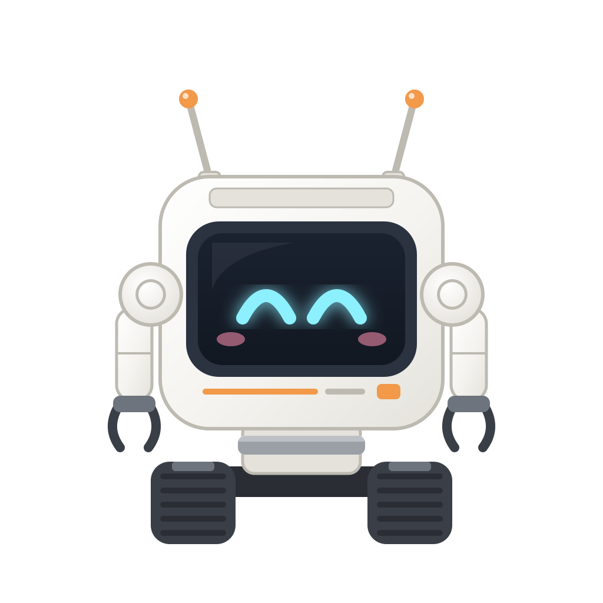
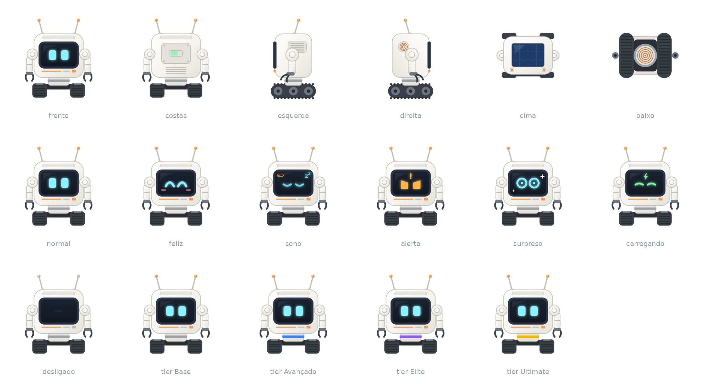

# Cubit

  

Um robô companheiro fofo, movido a bateria, para Minecraft 1.21.1 com NeoForge. Funciona só com ele e suas dependências, e também é testado no modpack [Iron Meridian](https://github.com/marcelofabianov/iron-meridian). O Cubit é craftado com recursos do jogo puro.

> **Status: Fase 2 encerrada, Fase 3 em andamento.** O mod ainda não tem versão publicada, e a primeira, `0.1.0`, sai ao terminar a Fase 3. Já funcionam colocar e recolher o Cubit, seguir o player, vários Cubits com um seguindo, as reações a fogo, lava e blocos que ferem, o inventário, a bateria com recarga por redstone, o Induction Dock, a morte com o item danificado, o conserto e o comando `/cubit reset`. Na Fase 3, já entraram os sons, as expressões, as animações, a barra de vida, a cor do colar, o indicador de bateria, os textos curtos, a lanterna, o painel solar, a cor da carcaça, o nome, a detecção dos scanners, numa esfera em volta do Cubit, as caixas em volta do que eles acham e as falas, inclusive sobre a redstone que você minera. O resto abaixo está planejado, e os números são o ponto de partida para o balanceamento.

## O que o Cubit faz

O Cubit segue você e ajuda em tarefas simples:

- **Carrega itens** no próprio inventário e coleta o que está no chão, com um filtro de coleta.
- **Funciona com bateria**, que você precisa gerenciar. Sem carga, ele desliga, e só dá para recolhê-lo ou colocar energia nele.
- **Recarrega** no Induction Dock, uma base fixa alimentada por FE de qualquer mod ou por redstone, onde ele hiberna com o inventário acessível. Também recarrega com uma Power Bank ou redstone no slot exclusivo, ou pelo painel solar, com o céu aberto.
- **Vira item**, mantendo bateria, vida, inventário, nome, cor, tier e configurações, menos as marcações no mundo, como a área. Ao morrer, vira um Damaged Cubit, que nenhum dano destrói, não some com o tempo e se conserta com uma Toolbox.
- **Reage ao perigo**: em chamas, procura água para se apagar; na lava ou sobre um bloco que fere, tenta sair. O dono não consegue feri-lo, exceto com o fogo de um isqueiro.
- **Ilumina o caminho** e coloca tochas sozinho.
- **Avisa você** sobre mobs hostis e procura os minérios que você escolher.
- **Protege você** com um choque leve, nos modos pacífico, contra-atacar e agressivo. Nunca ataca o dono nem mobs pacíficos.
- **Trabalha sozinho**: atua numa área marcada, descarrega em baús marcados, funde minérios, carrega suas ferramentas elétricas e guia você até o local da sua morte.
- **Tem personalidade**: a tela do rosto muda de expressão, e ele se comunica com bipes e textos curtos, comentando o tempo, os biomas e as suas conquistas, com uma chave para desligar.

Você pode ter quantos Cubits quiser trabalhando em áreas marcadas, mas só um segue você por vez.

## Visual

Um corpo branco e arredondado, com uma tela no rosto e olhos que brilham, duas antenas, braços com garras e esteiras no lugar dos pés. Tem um painel solar em cima, um indicador de bateria nas costas e uma bobina de indução embaixo. O colar no pescoço mostra o tier, e a cor da carcaça muda com corantes.

## Tiers

O Cubit mantém os recursos ao evoluir, e cada tier os melhora. Os recursos avançados ficam bloqueados até o tier certo.

| | Base | Avançado | Elite | Ultimate |
|---|---|---|---|---|
| Cor do colar | Cinza | Azul | Roxo | Dourado |
| Vida | 25 | 50 | 100 | 200 |
| Velocidade | 1,0× | 1,25× | 1,5× | 2,0× |
| Bateria | 300 mil FE | 600 mil FE | 3 mi FE | 8 mi FE |
| Autonomia em movimento, sem o painel e com a lanterna apagada | ~16,7 min | ~27,8 min | ~1,9 h | ~3,7 h |
| Capacidade da Power Bank | 210 mil FE | 420 mil FE | 2,1 mi FE | 5,6 mi FE |
| Inventário | 27 slots | 36 slots | 45 slots | 54 slots |
| Raio do ímã | 1 bloco | 3 blocos | 5 blocos | 8 blocos |
| Raio do scanner | 5 blocos | 10 blocos | 16 blocos | 24 blocos |
| Modos de defesa | Pacífico | + Contra-atacar | + Agressivo | Todos |
| Modo área | Bloqueado | Até 16×16 | Até 32×32 | Até 64×64 |

## Itens e blocos

Os nomes estão em inglês porque são os que aparecem no jogo.

| Nome | Descrição |
|---|---|
| Cubit | Robô companheiro, colocado no mundo como item |
| Damaged Cubit | O que cai quando o Cubit morre. Guarda o estado dele e não pode ser colocado no mundo |
| Toolbox | Conserta o Damaged Cubit e é consumida a cada conserto |
| Cubit Remote | Envia comandos aos Cubits, marca áreas de trabalho e localiza os Cubits |
| Advanced Module | Leva o Cubit do tier Base para o Advanced |
| Elite Module | Leva o Cubit do tier Advanced para o Elite |
| Ultimate Module | Leva o Cubit do tier Elite para o Ultimate |
| Induction Dock | Base de recarga do Cubit, alimentada por cabos ou redstone |
| Base Power Bank | Bateria portátil com a capacidade do tier Base |
| Advanced Power Bank | Bateria portátil com a capacidade do tier Advanced |
| Elite Power Bank | Bateria portátil com a capacidade do tier Elite |
| Ultimate Power Bank | Bateria portátil com a capacidade do tier Ultimate |

As receitas usarão só materiais do jogo puro, podendo combinar itens do próprio mod, como no conserto, e virão em datapack JSON, para os modpacks poderem sobrescrevê-las.

## Roadmap

1. **Conceito (encerrada):** persona, features e demais definições, em documentos.
2. **Versão mínima (encerrada):** crafting, seguir o player, inventário, bateria com consumo por situação, vários Cubits com um seguindo, `/cubit reset`, reações a fogo, lava e blocos que ferem, Induction Dock com hibernação, recarga com redstone, virar item, morte com item danificado e conserto, e geometria mais próxima do conceito.
3. **Sentidos (em andamento):** painel solar, lanterna, scanners, os nove sons, textos curtos, animações, expressões na tela, nome, cor e Jade.
4. **Upgrades e autonomia:** tiers, Power Bank, ímã, filtros, demais slots exclusivos, choque, modos de defesa, Cubit Remote, modo área, descarga em baú, retorno automático e local de morte.
5. **Trabalhos (planejada):** cards de Aprendizado de Máquina, antenas, Servidor, carregamento de chunks e storage wireless.

## Stack

- Minecraft 1.21.1, NeoForge 21.1.x e Java 21
- [GeckoLib](https://modrinth.com/mod/geckolib) para o modelo e as animações
- [LambDynamicLights](https://modrinth.com/mod/lambdynamiclights) como dependência obrigatória, para a luz dinâmica, a partir da lanterna, na Fase 3
- Forge Energy (FE), pelas capabilities do NeoForge

## Documentação

- [`_docs/README.md`](_docs/README.md): mapa dos documentos, com persona, visual, funcionalidades, itens, tiers, decisões, perguntas por fase e glossário
- [`AGENTS.md`](AGENTS.md): regras e contexto do projeto para desenvolvedores e agentes
- [`checklist.md`](checklist.md): o que está pronto e o que falta em cada fase

## Licença

[MIT](LICENSE)
