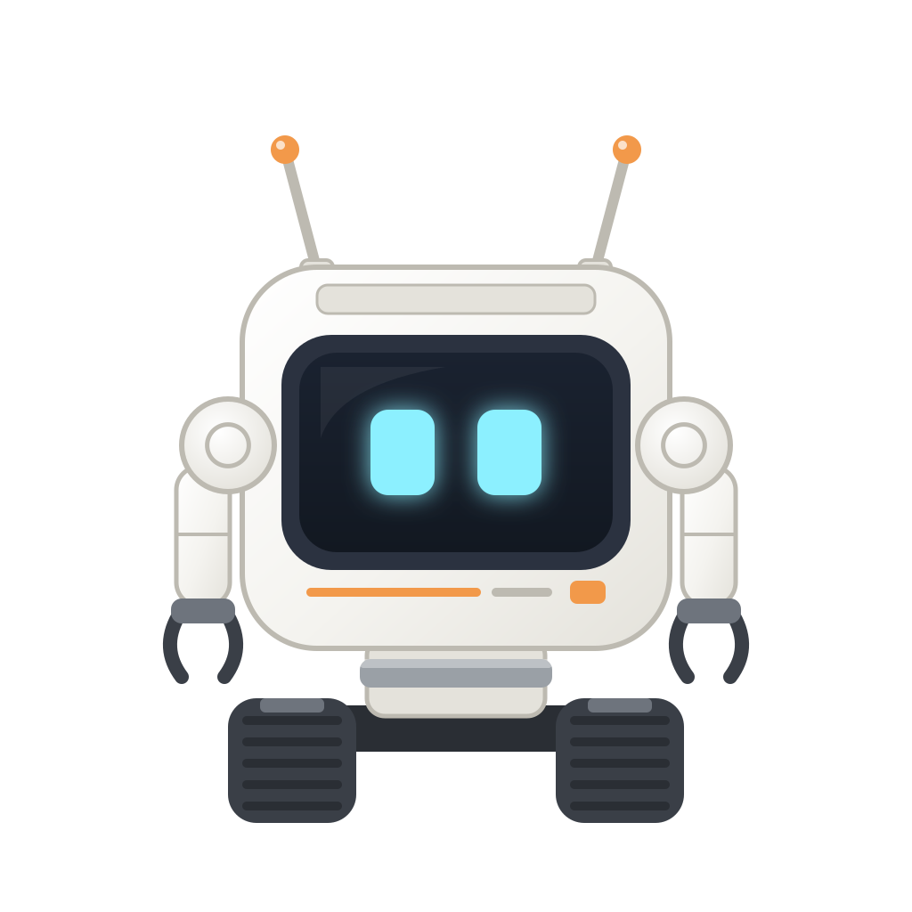
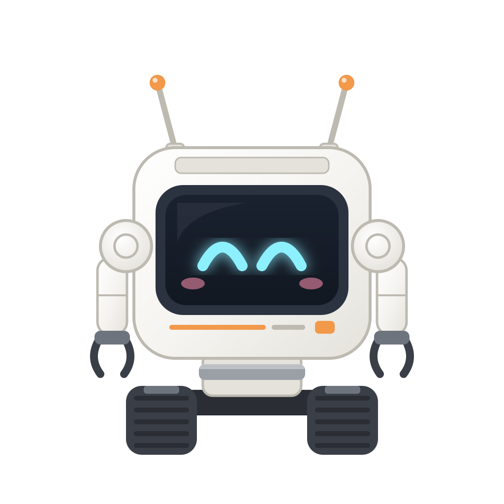
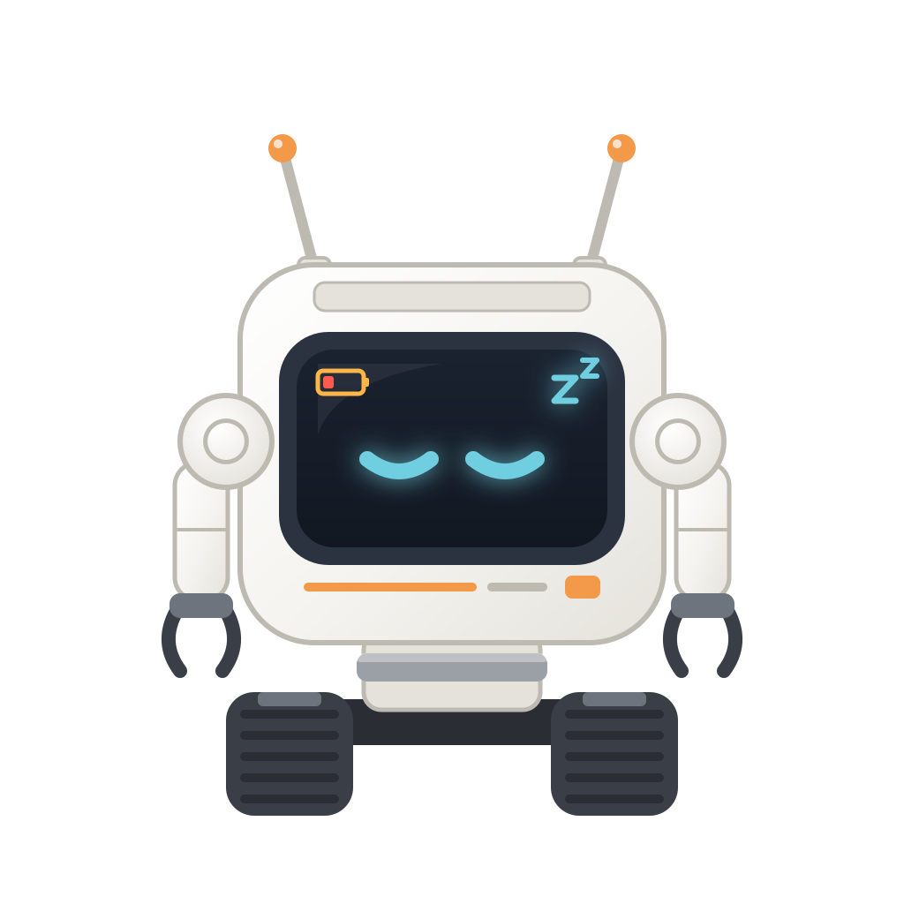
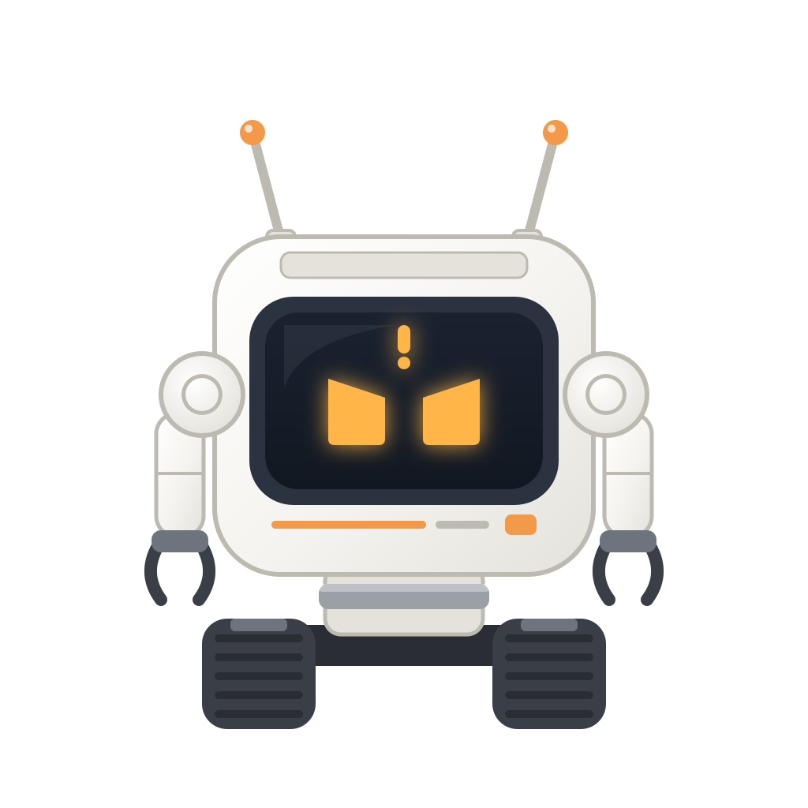
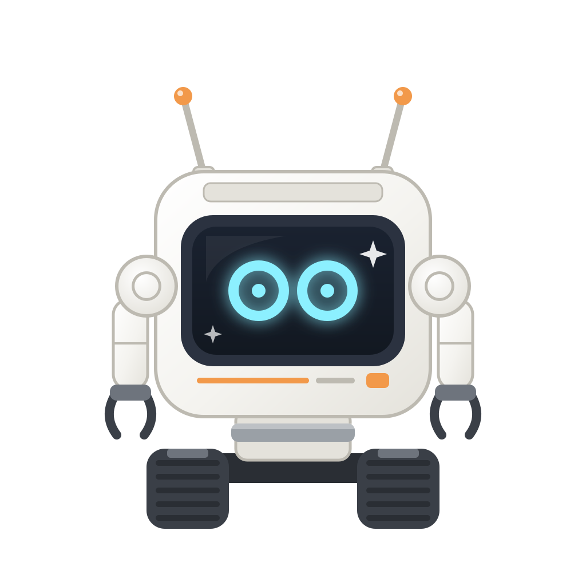
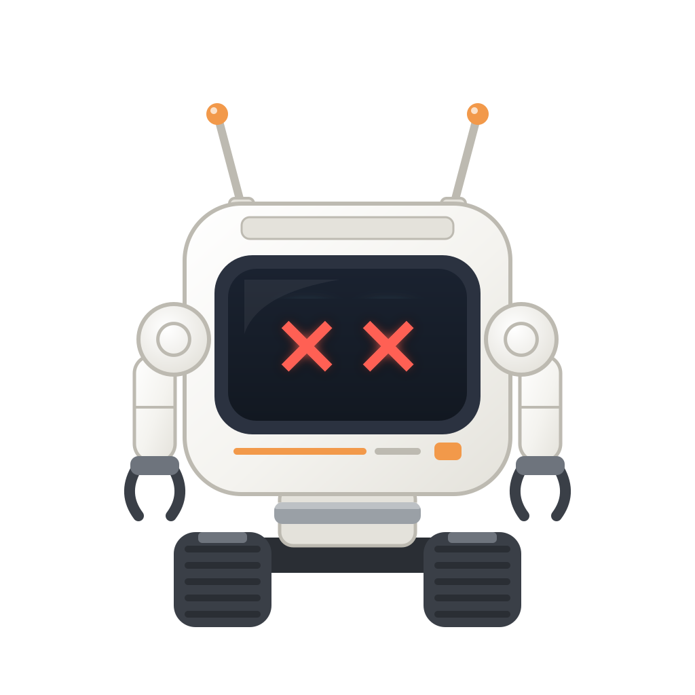
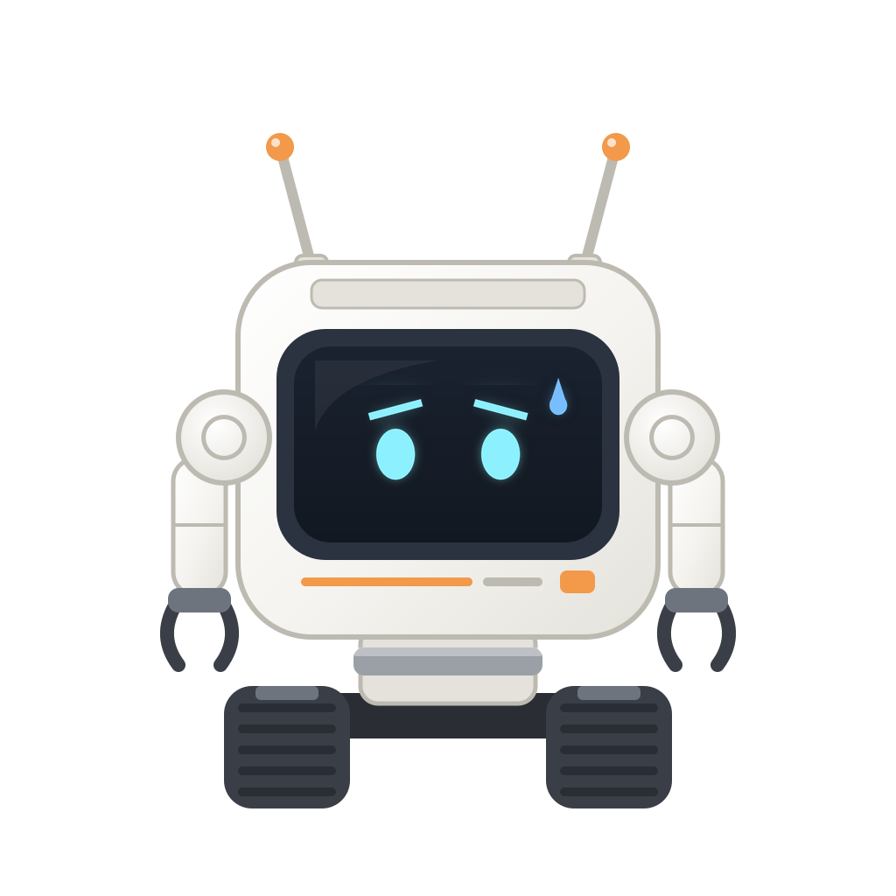
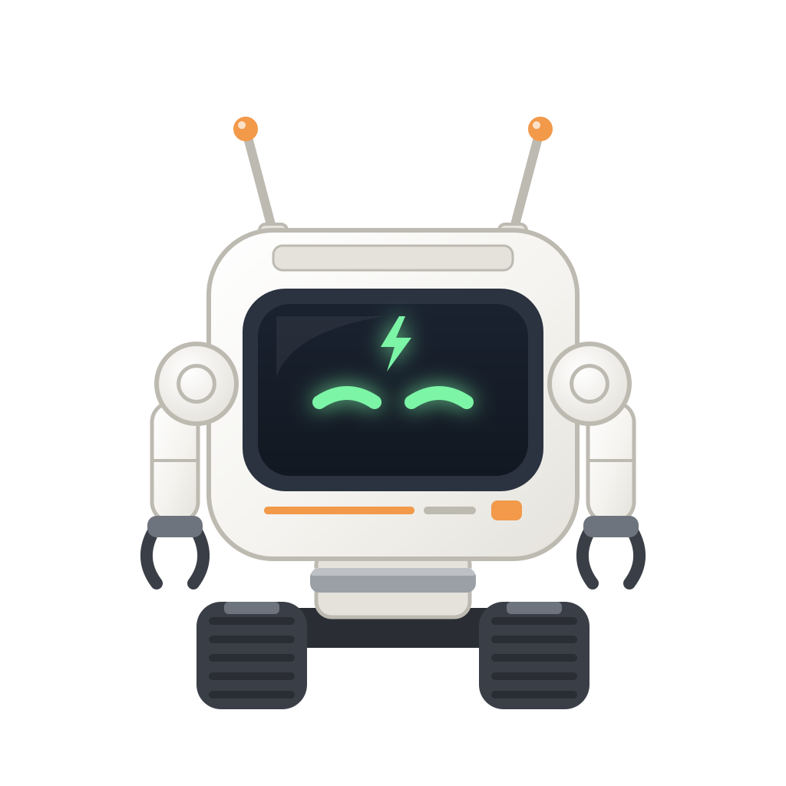
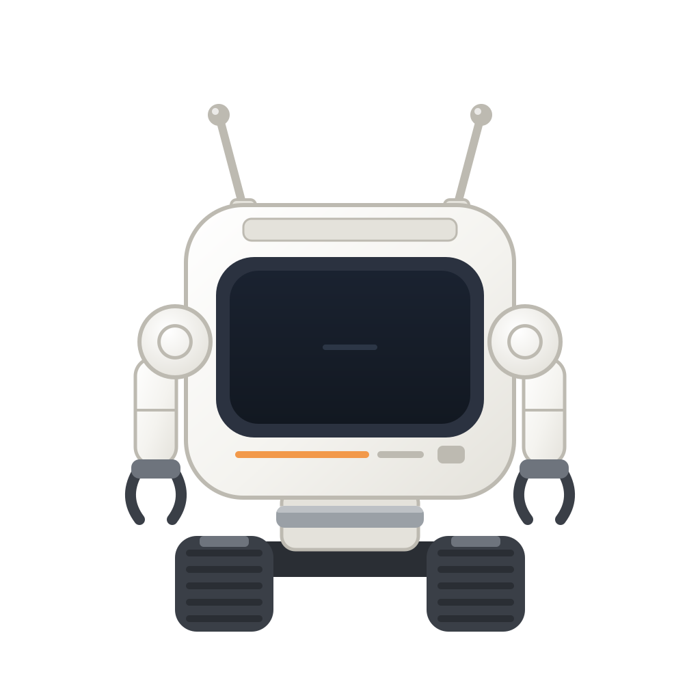

# Expressões

Como cada expressão é desenhada e qual vence estão em [`visual.md`](visual.md#expressões), e os gatilhos, em [`persona.md`](persona.md#reações).

| Imagem | Expressão | Quando é usada |
|---|---|---|
|  | Normal | Quando não há nada acontecendo, piscando a cada 5 s e olhando para cima ou para baixo ao subir ou descer, e conforme a altura do dono por perto |
|  | Feliz | Por cerca de 3 s, ao ser colocado ativo, ao abrir o inventário, ao ser pintado ou ao receber uma etiqueta |
|  | Sono | Com a bateria em 5% ou menos, com o robô ligado |
|  | Alerta | Com um inimigo por perto, quando os scanners entrarem |
|  | Surpreso | Ao encontrar um minério raro, quando os scanners entrarem |
|  | Triste | Por cerca de 5 s depois de levar qualquer dano, com o robô ligado |
|  | Quase morto | Por cerca de 3 s depois de levar dano com a vida em 10% ou menos, com o robô ligado |
|  | Preocupado | Por cerca de 3 s, no robô que segue, quando o dono leva dano a até 16 blocos |
|  | Carregando | Enquanto hiberna na base, sempre |
|  | Desligado | Com o robô desligado, mesmo recarregando pelo slot, com as antenas cinza |

## Histórico de modificações

| Pessoa | Data e hora | Modificação |
|---|---|---|
| Marcelo Fabiano | 2026-11-06 15:58 | Adiciona as reações a pintar e a nomear. |
| Marcelo Fabiano | 2026-11-06 09:48 | Reduz o sono para 5% de bateria. |
| Marcelo Fabiano | 2026-11-06 01:20 | Cita o olhar para o dono. |
| Marcelo Fabiano | 2026-11-06 00:28 | Define o tempo dos olhos em X. |
| Marcelo Fabiano | 2026-11-06 00:22 | Adiciona a expressão de preocupado. |
| Marcelo Fabiano | 2026-11-06 00:17 | Aumenta o tempo da expressão triste. |
| Marcelo Fabiano | 2026-11-06 00:10 | Adiciona as expressões triste e quase morto. |
| Marcelo Fabiano | 2026-11-05 23:56 | Cita a piscada e o olhar. |
| Marcelo Fabiano | 2026-11-05 23:41 | Cria a lista das expressões. |
