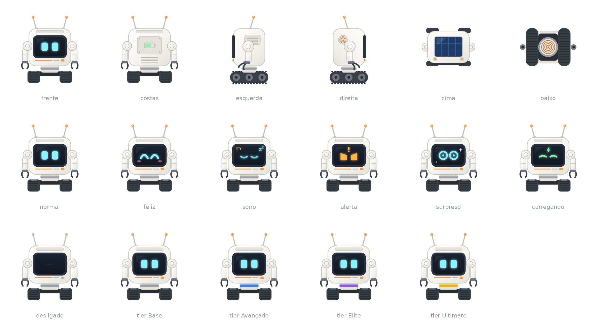

# Visual e sons

As imagens individuais estão em [`_docs/imagens/conceito/`](../imagens/conceito/), em PNG e SVG.

## Estilo

- **Moderno, fofo e doce:** um cubo branco arredondado com uma tela no rosto onde os olhos são luzes, antenas, braços com garras e **esteiras** no lugar dos pés.
- **Colar** no pescoço com a cor do tier. As cores estão em [`tiers.md`](../tiers.md).
- **Carcaça** com cor trocável por corantes.
- O conceito atual é a base. O modelo final tem **design próprio**, para o mod poder ser publicado. A geometria melhora já na Fase 2, mais próxima das imagens de conceito, e as animações e as expressões seguem na Fase 3.
- Modelo e animações com **GeckoLib**, dependência obrigatória: andar, virar a cabeça, mover os braços e trocar a expressão da tela.
- **Modelo na Fase 2:** traz os detalhes das seis vistas e o ícone do item, com tudo fixo: colar cinza, olhos normais e bateria sem variação. A textura tem 128×128, com 2 pixels por unidade, e a hitbox não muda, então braços e antenas passam um pouco dela.
- **Modelo final:** mantém a geometria e a textura do corpo, e acrescenta só os ossos que as animações precisarem.
- **Animações:** andar, olhar para o dono, parado, e desligado e hibernando. Como o modelo não tem cabeça separada, olhar gira o corpo sobre o pescoço, com as esteiras paradas. O robô olha só para o dono, ligado e com ele por perto, inclusive parado. Tempos e poses ficam no arquivo de animação, e o resto em constantes.
- **Esteiras:** textura por quadros, escolhidos pela distância andada, sem mudar a geometria.
- **Braços ao levar dano:** ficam erguidos enquanto durar a expressão triste ou de olhos em X, e o corpo e as antenas continuam balançando.
- **Inclinação para o dono:** com o dono 1 bloco ou mais acima ou abaixo, com o robô ligado, na mesma dimensão e até 8 blocos, o corpo inclina cerca de 8° para cima ou para baixo, com transição suave. Um pulo move só os olhos.

## O que o conceito mostra

- **Vistas:** frente, costas, esquerda, direita, cima e baixo.
- **Corpo:** tela escura no rosto, olhos ciano e antenas com ponta laranja.
- **Detalhes:** painel solar em cima, indicador de bateria nas costas e bobina de indução embaixo. O painel carrega a bateria, conforme [`energia.md`](../funcionalidades/energia.md#painel-solar).
- **Desligado:** a tela apaga e as pontas das antenas ficam cinza.

## Expressões

São dez: normal, feliz, sono, alerta, surpreso, carregando, desligado, triste, quase morto e preocupado. Os gatilhos estão em [`persona.md`](persona.md#reações), e a lista, com as imagens, em [`expressoes.md`](expressoes.md).

- **Desenho:** cada uma é uma camada só para a tela, em `textures/entity/general_robot_screen/`, com 8× a resolução do corpo, ou 144×88 pixels na tela, recortada das imagens de conceito. O corpo não muda.
- **Brilho:** a tela brilha no escuro. Desligada, não brilha, e as pontas das antenas ficam cinza.
- **Qual vence:** tela apagada, carregando, quase morto, triste, preocupado, alerta, surpreso, sono, feliz e normal.
- **Triste e quase morto:** triste dura o tempo de [`tiers.md`](../tiers.md#valores-gerais) depois de um dano, e quase morto, com a vida no limite da mesma tabela, dura menos, e a lágrima segue até o fim do tempo dela. Ao levar dano, toca o curto elétrico, no lugar do som padrão do jogo e sem bipe. Em chamas, o loop já toca, e os golpes do fogo não o repetem.
- **Feliz:** dura o tempo de [`tiers.md`](../tiers.md#valores-gerais), depois de colocar o robô ou abrir o inventário.
- **Bipe:** toca ao trocar para normal, feliz ou sono, exceto ao ligar, ao ser colocado e ao carregar o mundo.
- **Piscada:** na expressão normal, fica 5 s de olhos abertos e pisca em cerca de 0,25 s, sem bipe. Cada robô começa num momento diferente.
- **Olhar:** na expressão normal, os olhos sobem cerca de 1/6 da tela ao subir e descem ao descer, um ou mais blocos, e ficam assim por cerca de 0,5 s depois do movimento.
- **Olhar para o dono:** sem movimento próprio, com o robô ligado, na mesma dimensão e o dono a até 8 blocos, os olhos também sobem num pulo e descem numa queda rápida dele, por cerca de 0,5 s, e ficam para cima ou para baixo enquanto ele estiver 1 bloco ou mais acima ou abaixo do robô.
- **Em uso:** normal, feliz, sono, carregando, desligado, triste, quase morto e preocupado. Alerta e surpreso entram com os scanners.

## Sons

São onze sons diferentes (perguntas 135, 148, 316, 320, 322 e 362). Nove entram na Fase 3, o do ataque, junto do choque, e o de modo agressivo, junto dos modos de defesa. A lista, com o arquivo e o uso de cada um, está em [`sons.md`](sons.md).

Os arquivos ficam em `assets/cubit/sounds/general_robot/`, em Ogg Vorbis, mono e 48 kHz, porque o jogo só aceita esse formato e só reduz o volume com a distância em sons mono. O valor do intervalo mínimo será definido na Fase 3, num teste no jogo, e ficará no config.

Tocam todos, menos os alertas, que entram com os scanners, e o ataque e o modo agressivo, que entram na Fase 4.

- **IDs:** `cubit:general_robot.{nome}`, com o nome do arquivo sem a extensão. Não mudam sem aviso.
- **Quem ouve:** todos os players por perto, com o volume caindo até cerca de 16 blocos, no controle "Criaturas amigáveis" do jogo. Volume e alcance ficam no `sounds.json`, onde um pacote de recursos pode mudá-los.
- **Ligar:** de inativo para ativo, pelo clique, ao religar sozinho ou ao sair da base ligado.
- **Desligar:** de ativo para inativo, por bateria zerada, troca de robô ou `/cubit reset`.
- **Sem esses sons:** entrar na base e ser colocado no mundo.
- **Esteira:** em loop, enquanto anda, com volume e altura acompanhando a velocidade.
- **Curto elétrico:** em loop, enquanto pega fogo, ativo ou não, junto da esteira.
- **Recarga:** em loop, enquanto a bateria sobe de fato, na base ou pelo slot. Para com a bateria cheia ou com o Dock sem energia.

## Identificação

- **Ícone do mod:** tem o mesmo desenho do ícone do item, em `textures/gui/mod_logo.png`, sem borrar os pixels. O arquivo é separado porque a tela de Mods sempre encaixa o logo numa altura de 50 pixels, então o tamanho vem da margem transparente, e 25×25 dá a escala exata de 2×. Ao mudar o ícone do item, atualize também este arquivo.
- **Nome personalizado** com bigorna ou etiqueta, aparecendo no Jade.
- **Jade:** mostrar nome, tier, bateria e modo atual.

## Histórico de modificações

| Pessoa | Data e hora | Modificação |
|---|---|---|
| Marcelo Fabiano | 2026-11-06 01:00 | Corrige o bipe padrão, que já toca. |
| Marcelo Fabiano | 2026-11-06 01:20 | Adiciona os braços ao levar dano, o olhar e a inclinação para o dono. |
| Marcelo Fabiano | 2026-11-06 00:58 | Define as animações, as esteiras e o modelo final. |
| Marcelo Fabiano | 2026-11-06 00:28 | Define o tempo dos olhos em X. |
| Marcelo Fabiano | 2026-11-06 00:22 | Adiciona a expressão de preocupado. |
| Marcelo Fabiano | 2026-11-06 00:12 | Define o som ao levar dano. |
| Marcelo Fabiano | 2026-11-06 00:10 | Adiciona as expressões triste e quase morto. |
| Marcelo Fabiano | 2026-11-05 23:56 | Adiciona a piscada e o olhar. |
| Marcelo Fabiano | 2026-11-05 23:41 | Aponta para a lista das expressões. |
| Marcelo Fabiano | 2026-11-05 23:36 | Define como as expressões são desenhadas e qual vence. |
| Marcelo Fabiano | 2026-11-05 23:16 | Adiciona o som de modo agressivo. |
| Marcelo Fabiano | 2026-11-05 22:47 | Passa a lista dos sons para `sons.md`. |
| Marcelo Fabiano | 2026-11-05 22:39 | Define quando cada som toca e quem ouve. |
| Marcelo Fabiano | 2026-11-05 21:30 | Separa o som de ligar do som de colocar. |
| Marcelo Fabiano | 2026-11-05 21:02 | Trata a GeckoLib como dependência do mod. |
| Marcelo Fabiano | 2026-11-05 20:36 | Define a fase do som de colocar no mundo. |
| Marcelo Fabiano | 2026-11-05 20:26 | Adiciona o som de colocar no mundo. |
| Marcelo Fabiano | 2026-11-05 17:27 | Adiciona o som do ataque. |
| Marcelo Fabiano | 2026-11-05 00:55 | Reduz o ícone do mod na tela de Mods. |
| Marcelo Fabiano | 2026-11-05 00:35 | Define o ícone do mod. |
| Marcelo Fabiano | 2026-11-05 00:31 | Define o modelo da Fase 2. |
| Marcelo Fabiano | 2026-11-05 00:12 | Limita o bipe padrão, antecipa a geometria e cita o intervalo mínimo. |
| Marcelo Fabiano | 2026-11-04 22:51 | Adiciona os arquivos dos sons. |
| Marcelo Fabiano | 2026-11-04 22:12 | Define os oito sons do Cubit. |
| Marcelo Fabiano | 2026-11-04 17:15 | Atualiza os caminhos após a renomeação para português. |
| Marcelo Fabiano | 2026-11-04 17:08 | Define o modelo final na Fase 3. |
| Marcelo Fabiano | 2026-11-04 16:57 | Atualiza as expressões, os sons e o painel solar. |
| Marcelo Fabiano | 2026-11-04 16:02 | Define a persona do Cubit. |
| Marcelo Fabiano | 2026-11-04 15:23 | Adiciona o rascunho da persona e o visual do Cubit. |
