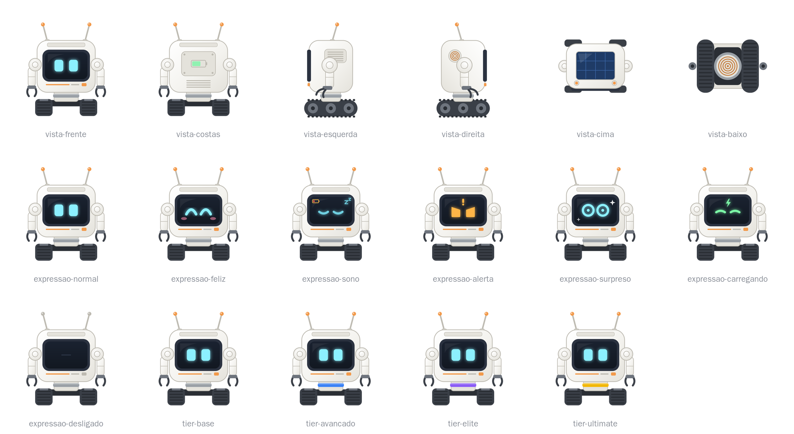

# Visual e sons

As imagens individuais estão em [`_docs/assets/concept/`](../assets/concept/), em PNG e SVG.

## Estilo

- **Moderno, fofo e doce:** um cubo branco arredondado com uma tela no rosto onde os olhos são luzes, antenas, braços com garras e **esteiras** no lugar dos pés.
- **Colar** no pescoço com a cor do tier. As cores estão em [`tiers.md`](../tiers.md).
- **Carcaça** com cor trocável por corantes.
- As referências servem só como estilo. O modelo final precisa de um **design próprio** (proporções, cores e detalhes diferentes) para o mod poder ser publicado.
- Modelo e animações com **GeckoLib** (já presente no pack): andar, virar a cabeça, mover os braços e trocar a expressão da tela.

## O que o conceito mostra

- **Vistas:** frente, costas, esquerda, direita, cima e baixo.
- **Corpo:** tela escura no rosto, olhos ciano e antenas com ponta laranja.
- **Detalhes:** painel solar em cima, indicador de bateria nas costas e bobina de indução embaixo.
- **Desligado:** a tela apaga e as pontas das antenas ficam cinza.

## Expressões

- **Definidas nas features:** feliz, com sono (bateria baixa), alerta (inimigo) e surpreso (minério raro).
- **Só no conceito, a confirmar:** normal, carregando e desligado.

## Sons

- Um som em loop para as **esteiras**, acompanhando a velocidade.
- Sons curtos de alerta para **inimigos** e **minérios raros** (de ferro para cima), com intervalo mínimo entre repetições.

## Identificação

- **Nome personalizado** com bigorna ou etiqueta, aparecendo no Jade.
- **Jade:** mostrar nome, tier, bateria e modo atual.
