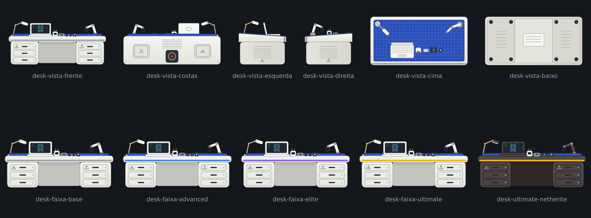
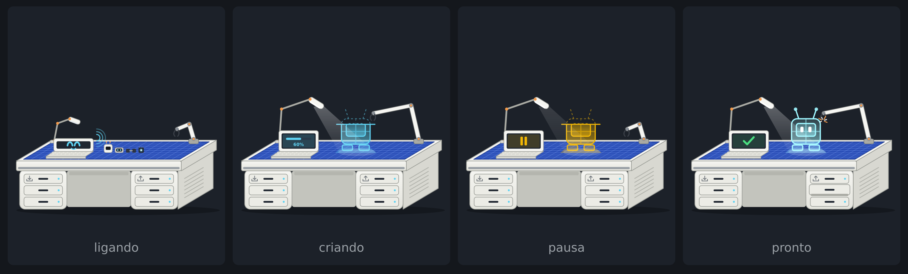
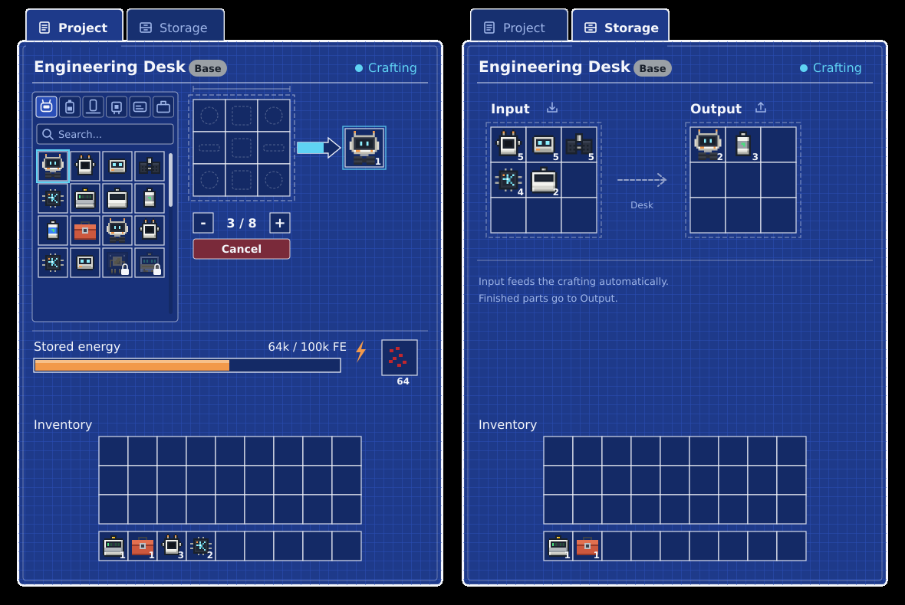

# Mesa de Engenharia

A Engineering Desk, `cubit:engineering_desk`, é a mesa de criação do mod: todo item do Cubit sai dela, e ela fabrica sozinha, com FE, a partir de um pedido (issue #231, perguntas 1424 a 1484). Os números estão em [`tiers.md`](../tiers.md#engineering-desk).

## Por quê

- **Primeiro contato:** é a primeira coisa que o player faz no mod, e o visual dela tem a prioridade mais alta. Precisa causar a melhor impressão possível (pergunta 1463).
- **Oficina de engenharia:** o Cubit é tecnologia e construção, e os itens dele saem de uma mesa de projetista, e não da mesa de craft do jogo.
- **Automação:** a mesa recebe os materiais por um lado e entrega os itens prontos por outro, para encaixar numa linha de produção.

## Receita da própria mesa

- **Única na mesa do jogo:** a Engineering Desk é a única receita do mod que fica na mesa de craft do jogo (pergunta 1430). Todas as outras saem dela, inclusive as que carregam estado: o upgrade da Power Bank, o Dock Solar, religar o Cubit com a Power Bank e o conserto com a Toolbox (pergunta 1427).
- **Grade:** painel de vidro, redstone, painel de vidro / baú, mesa de craft, baú / lingote de ferro, lingote de ferro, lingote de ferro. O laptop em cima, os gaveteiros nas laterais.
- **Livro:** aparece no livro de receitas do jogo desde o início.
- **Primeira mesa:** ao colocar a primeira mesa, um texto curto, no estilo dos textos do Cubit, diz para escolher uma receita no catálogo e alimentar a mesa com redstone ou FE (pergunta 1479).

## Bloco

- **Tamanho:** ocupa 2 blocos na lateral. O bloco clicado é a metade da esquerda, a da entrada, e a outra metade vai para a direita do player. Sem espaço livre para as duas, nada é colocado, e o item continua na mão (pergunta 1456).
- **Frente:** o laptop fica virado para o player que coloca.
- **Quebrar:** só o dono, ou um operador no modo criativo, como no Dock. Explosões e pistões não a afetam. Quebrar qualquer metade quebra a mesa e solta um item só (perguntas 524 e 1445).
- **Item:** guarda o tier, a energia, os dois inventários e a receita configurada, e a mesa volta igual ao ser colocada (pergunta 1432). Empilha em 1.
- **Aninhar:** com itens dentro, o item não entra em shulker boxes, no inventário do Dock nem no do Cubit. Vazio, entra normalmente (pergunta 1481).
- **Tooltip:** o tier na cor dele, a energia guardada, a receita com o pedido e quantos itens há nos dois inventários. O ícone mostra a faixa do tier (pergunta 1476).
- **Dono:** qualquer player abre a mesa e usa. Só o dono sobe o tier (pergunta 1431).

## Lados

Olhando de frente para o laptop (perguntas 1425, 1436 e 1447):

| Face | O que faz |
|---|---|
| Esquerda | Põe itens no inventário de entrada |
| Direita | Tira itens do inventário de saída |
| Trás | Põe na entrada e tira da saída |
| Baixo | Recebe FE e itens de redstone, que vão para o slot de energia |
| Cima | Fechado: não aceita nem entrega itens |

A redstone que entra pelos lados ou por trás vai para o inventário de entrada, como material.

## Inventários

- **Entrada:** guarda os materiais, colocados pelo player ou por automação. Aceita só itens usados em alguma receita do mod, para o lixo de uma automação não entupir a mesa (pergunta 1446).
- **Saída:** recebe os itens prontos. O player e a automação só tiram dela.
- **Slots novos:** ao subir de tier, os slots a mais aparecem vazios, e os itens continuam onde estavam.

## Energia

- **Bateria interna:** como no Induction Dock, alimentada por cabos FE ou por redstone, em pó e em bloco, no slot de energia (pergunta 1425). Um item de redstone só vira energia quando couber inteiro na bateria.
- **Entrada:** 5.000 FE/t, igual em todos os tiers, como no Dock.
- **Custo:** cada craft pronto desconta 2.500 FE, igual em todas as receitas e em todos os tiers (perguntas 1435 e 1460).

## Receita e pedido

- **Grade de 9 slots:** mostra marcações dos itens, não itens reais. O player escolhe a receita no catálogo, e a grade se preenche, ou marca à mão, arrastando um item para a grade, e a mesa reconhece a receita (pergunta 1426).
- **Catálogo:** mostra todas as receitas do mod, na ordem em que são liberadas (pergunta 1499), em categorias com ícones (Cubit e peças, Energia, Dock, Modules, Cards e Ferramentas) e com um campo de busca pelo nome (pergunta 1474).
- **Bloqueadas:** aparecem com o item escurecido e acinzentado, com o nome e `Locked`, sem os materiais, e não podem ser escolhidas nem marcadas à mão. Desbloqueiam na ordem de [`itens.md`](../itens.md#progressão-das-receitas), com o Cubit e as peças desde o início (perguntas 1441 e 1495 a 1498). Assim o player vê tudo o que o mod tem e o que já abriu.
- **Um pedido por vez:** uma receita e uma quantidade. Para fabricar outra coisa, o player troca a receita (pergunta 1442).
- **Quantidade:** botões − e +, como no controle de velocidade. O clique muda 1, e com Shift muda 8, entre 1 e o maior pedido do tier. Um botão cancela o pedido (pergunta 1444).
- **Trocar a receita:** zera o pedido e o progresso, e os materiais continuam no inventário de entrada.
- **Só do mod:** a mesa não fabrica receitas do jogo.

## Fabricação

- **Uma unidade por vez:** cada craft leva o tempo do tier. Ao terminar, a mesa consome os materiais e o FE de uma vez, e o item vai do slot de saída da receita para o inventário de saída. O contador desce, e a mesa para no zero (pergunta 1429).
- **Atomicidade:** os materiais e o FE só saem no fim do craft. Nada fica pela metade, e nada é criado nem perdido (regra 13).
- **Pausa:** sem material, sem energia, com a saída cheia ou com sinal de redstone, a mesa pausa sem perder o progresso, mostra o motivo na tela e no Jade e volta sozinha quando a causa some (perguntas 1443 e 1448).
- **Chunk:** a mesa só trabalha com o chunk carregado (regra 22).

### Cascata

Uma receita feita de itens que a própria mesa fabrica, como o Cubit, feito das quatro peças, continua sozinha (perguntas 1500 a 1503), em todos os tiers:

- **Quando:** ao escolher a receita no catálogo e, durante o pedido, sempre que faltar material na entrada.
- **Condição:** a entrada e a saída juntas têm os materiais de uma unidade. A mesa puxa da saída só o que falta na entrada.
- **Sem espaço:** a mesa move o que couber na entrada, e o resto fica na saída.
- **Nada se perde:** os itens só passam de um inventário da mesa para o outro, e um item só sai da saída depois de entrar na entrada (regra 13).
- **Sinal de redstone:** com a mesa pausada pelo sinal, nada se move.

### Receitas com estado

- **Item real:** a mesa usa o primeiro item do inventário de entrada que serve, na ordem dos slots, e passa o estado como hoje (pergunta 1427).
- **Upgrade da Power Bank:** se a carga não couber na nova, a receita não roda, e a tela explica por quê (pergunta 907).
- **Dock Solar:** o Dock passa o tier, a energia e o inventário para o Dock Solar.
- **Religar o Cubit:** a Power Bank volta para o inventário de saída com a carga que sobrou, junto do Cubit.
- **Conserto:** a Toolbox é consumida, e o Cubit sai como no conserto de hoje.

## Redstone

- **Sinal:** com sinal de redstone, a mesa pausa o pedido sem perder o progresso (pergunta 1448).
- **Comparador:** lê o que falta do pedido: 15 no início, descendo até 0 no fim, e 0 sem pedido. Com 4 de 8 feitos, o sinal fica em 8 (perguntas 1449 e 1453).

## Tiers

- **Subir:** o clique direito na mesa com o Module do tier seguinte sobe a mesa, sem pular etapas, e consome o Module, como no Dock. O que não serve não é consumido, e um texto explica o motivo. Para usar um Module como material, o player o põe pela tela (pergunta 1462).
- **O que muda:** o tempo por craft, o maior pedido, a bateria e os slots dos dois inventários (perguntas 1433 e 1434).
- **No bloco:** uma faixa na cor do tier, cinza, azul, roxa ou dourada, na borda do tampo e, no Ultimate, o corpo em netherite (pergunta 1439).

## Visual

O modelo e as animações são feitos no GeckoLib, no Blockbench (pergunta 1464), a partir das imagens conceito aprovadas pelo desenvolvedor (perguntas 1440 e 1480).

As imagens são a referência, com seis ajustes aplicados no modelo, na textura e na tela (pergunta 1487):

1. A tomada de energia fica embaixo, e não nas costas.
2. As miniaturas ficam maiores, para não virarem 2 ou 3 pixels no jogo.
3. A faixa do Base fica num cinza mais escuro, para aparecer no tampo branco.
4. As miniaturas aparecem em todos os estados, também criando, na pausa e com o item pronto.
5. A luminária fica em meia luz na pausa.
6. A grade da tela mostra as marcações da receita escolhida.

- **A mesa:** uma mesa de projetista com um laptop em cima, miniaturas do Cubit e das peças sobre um forro azul com linhas quadriculadas, um gaveteiro de cada lado, um braço mecânico articulado e uma luminária de LED num suporte articulado (perguntas 1455 e 1465).
- **Ligação:** ao ser colocada, toda vez, o laptop abre, a tela liga com o logo do Cubit e toca o bipe de ligação, e depois a mesa fica no estado parado (pergunta 1466).
- **Laptop:** a tampa abre quando o player abre a tela e fecha quando ele sai. A tela fica acesa, com um leve pulso, enquanto cria, apagada parada e com outra cor na pausa (perguntas 1454 e 1465).
- **Gavetas:** abrem um instante quando um item entra pela esquerda ou sai pela direita, pelo player ou por automação.
- **Criando:** a luminária se move e acende em branco frio, o braço trabalha sobre o forro, e o laptop projeta o holograma azul do item da receita, que se completa com o progresso (pergunta 1465).
- **Luz:** a luminária emite luz de nível 7 enquanto a mesa cria, e nenhuma parada. O laptop brilha só na textura (perguntas 1457 e 1469).
- **Pausa:** o braço volta ao repouso, a luminária fica em meia luz, e o holograma para no progresso atual, piscando devagar na cor de pausa (pergunta 1470).
- **Pronto:** o holograma se completa e brilha, o braço solta faíscas, toca o som de pronto, e a gaveta da direita abre e fecha. No fim do pedido, a luminária apaga, e o braço volta ao repouso (pergunta 1471).

## Sons

Três arquivos `.ogg` próprios, em `sounds/engineering_desk/`, registrados como eventos de som do mod para o pack poder trocar (perguntas 1450 a 1452 e 1477). As descrições ficam em [`sons.md`](../conceito/sons.md).

- **Criando:** um loop baixo e contínuo, que para na pausa e no fim do pedido.
- **Pronto:** toca quando cada item fica pronto.
- **Ligação:** o bipe da animação de ligação.

## Tela

Uma prancheta de projetista: fundo azul quadriculado, como o forro, a grade de marcações em linhas brancas de planta técnica e o catálogo de receitas (pergunta 1467).

- **Aba Projeto:** o catálogo, a grade com a quantidade, os botões − e + e o de cancelar, a seta de progresso, o slot de saída da receita, a barra de energia, o slot de redstone e o tier na cor dele (pergunta 1473).
- **Aba Estoque:** os dois inventários lado a lado, a entrada à esquerda e a saída à direita, como na mesa.
- **As duas abas** mostram o inventário do player.

## Jade

O gráfico do progresso do craft, o item que será entregue, quanto falta do pedido, como `3/8`, a energia, o tier na cor dele, o dono e, na pausa, o motivo (perguntas 1468 e 1472).

## JEI

Um plugin opcional do JEI, isolado em `compat/jei`, como o do Jade, que mostra as receitas da mesa. O mod abre sem o JEI (perguntas 1461 e 1486 e regra 24). A versão é a do Iron Meridian, `19.64.0.455`. Muda a 1284: o JEI deixa de ser só do cliente de teste, e o mod passa a ter o plugin.

## Segurança e defesa

- **Autoridade do servidor:** a receita, a quantidade e o cancelamento são pedidos do cliente, conferidos no servidor, com a distância até a mesa (regras 19 e 20).
- **Dono:** o servidor confere o dono ao subir o tier e ao quebrar.
- **Dado inválido:** uma receita salva que deixou de existir, como a removida por um pack, zera o pedido e registra no log (regra 17).
- **Fora do escopo:** o Cubit usando a mesa fica para depois (regra 43).

## Contrato

| Onde | Nome | Conteúdo |
|---|---|---|
| Bloco e item | `cubit:engineering_desk` | A mesa, com as duas metades |
| Tipo de receita | `cubit:engineering` | Com forma ou sem forma, como as do jogo, com o desenho espelhado valendo (pergunta 1459) |
| Receitas | Os IDs de hoje, como `cubit:general_robot` | Mantêm o ID e passam ao tipo da mesa. Os tipos especiais, como `cubit:power_bank_upgrade`, `cubit:solar_dock_assembly`, `cubit:robot_recharge` e `cubit:robot_repair`, mantêm o nome e rodam só na mesa (pergunta 1438) |
| Config, por tier, em `[general_robot.{tier}]` | `engineering_desk_energy_capacity`, `engineering_desk_craft_ticks`, `engineering_desk_storage_slots` e `engineering_desk_max_order` | A bateria, o tempo por craft, os slots de cada inventário e o maior pedido (pergunta 1475) |
| Config, em `general` | `engineering_desk_craft_energy` e `engineering_desk_input_per_tick` | O custo por craft, com 2.500 FE, e a entrada de energia, com 5.000 FE/t |
| Componentes do item | `cubit:engineering_desk_tier`, `cubit:engineering_desk_energy`, `cubit:engineering_desk_input`, `cubit:engineering_desk_output` e `cubit:engineering_desk_order` | O tier, a energia, os dois inventários e o pedido, com a receita e a quantidade, que voltam ao colocar a mesa (pergunta 1492) |
| Attachment do player | `cubit:engineering_desk_seen` | Se o player já colocou uma mesa, para o texto da primeira mesa aparecer uma vez só (pergunta 1492) |
| Sons | `cubit:engineering_desk.crafting`, `cubit:engineering_desk.done` e `cubit:engineering_desk.startup` | O loop de criando, o som de pronto e o bipe de ligação |
| Changelog | Aviso | As receitas do mod saem da mesa de craft do jogo e passam ao tipo da mesa |

## Entrega

Uma issue mãe e quatro PRs, em ordem, cada um testável no jogo (pergunta 1478):

1. Bloco, energia, inventários, pedido, receitas na mesa e lados, com o modelo final no GeckoLib, ainda sem animações, e a tela funcional, já com as abas e o catálogo, no visual simples das telas atuais (perguntas 1493 e 1494).
2. Animações, luz e sons.
3. Tela de prancheta, com as categorias e a busca, e Jade.
4. JEI.

## Histórico de modificações

| Pessoa | Data e hora | Modificação |
|---|---|---|
| Zennd | 2026-11-21 14:00 | Adiciona a cascata (perguntas 1500 a 1503). |
| Zennd | 2026-11-21 13:50 | Ordena o catálogo pela liberação (pergunta 1499). |
| Zennd | 2026-11-21 13:40 | Escurece as receitas bloqueadas e aponta a ordem de liberação (perguntas 1495 a 1498). |
| Zennd | 2026-11-21 15:00 | Adiciona os componentes e o attachment e ajusta a divisão dos PRs (perguntas 1492 a 1494). |
| Zennd | 2026-11-21 14:10 | Adiciona as imagens conceito aprovadas e os ajustes (pergunta 1487). |
| Zennd | 2026-11-21 13:30 | Aponta a mudança da resposta 1284 no JEI (pergunta 1486). |
| Zennd | 2026-11-21 12:30 | Descreve a Engineering Desk (perguntas 1424 a 1484). |
