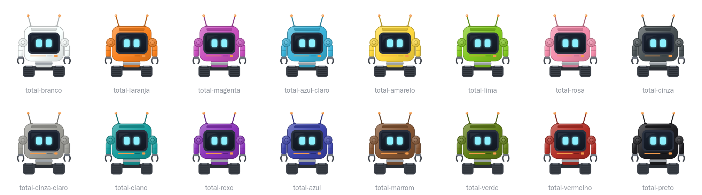

# Personalização

O dono escolhe a cor da carcaça e o nome de cada Cubit (perguntas 504 a 514).

## Cor da carcaça

- **Cores:** as 16 dos corantes do jogo. O branco é o visual original.
- **O que muda:** carcaça, ombros, braços, hastes das antenas e tronco.
- **O que não muda:** a fita e as faixas dos antebraços, na cor do tier, a tela, o indicador de bateria, o painel solar, as garras, as esteiras e as pontas das antenas.
- **Como pintar:** com clique direito do dono, em qualquer estado, porque pintar não gasta energia. Com shift, o clique continua recolhendo o Cubit.
- **Corante:** gasta 1, menos no criativo. Na mesma cor, nada acontece e nada é gasto, e o inventário não abre.
- **Quem não é dono:** nunca pinta.
- **Como é desenhado:** com uma textura do corpo por cor, escolhida pelo renderer, que um pacote de recursos pode trocar.
- **Ícone:** o do Cubit acompanha a cor. O do Damaged Cubit não muda, e a cor volta ao consertar. O colar no ícone continua cinza até a Fase 4 (pergunta 414).

## Nome

- **Etiqueta:** só do dono, em qualquer estado, e gasta 1, menos no criativo. Uma etiqueta sem nome não faz nada. A de quem não é dono não faz nada e não é gasta.
- **Bigorna:** renomeia o Cubit ou o Damaged Cubit como item, e o nome vale ao colocar.
- **Onde aparece:** sempre visível acima do Cubit, dentro do alcance normal do jogo, na tela do Cubit e no Jade.

## Reação

Com o Cubit ativo, pintar ou receber a etiqueta mostra a expressão feliz, com o bipe padrão. Com a tela apagada, nada aparece. Hibernando, a tela continua com a expressão carregando (pergunta 57).

## O que fica guardado

Recolher, morrer, consertar e salvar o mundo mantêm a cor e o nome. Saves antigos e valores inválidos abrem brancos, e o valor inválido vai para o log. Os nomes do save estão em [`itens.md`](../itens.md).

## Histórico de modificações

| Pessoa | Data e hora | Modificação |
|---|---|---|
| Marcelo Fabiano | 2026-11-07 23:42 | Atualiza onde o nome aparece. |
| Marcelo Fabiano | 2026-11-06 15:58 | Define a cor da carcaça e o nome. |
