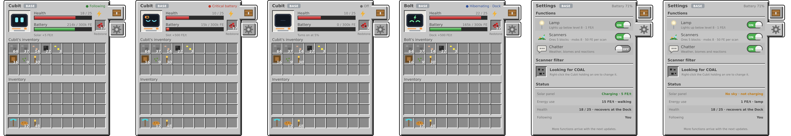
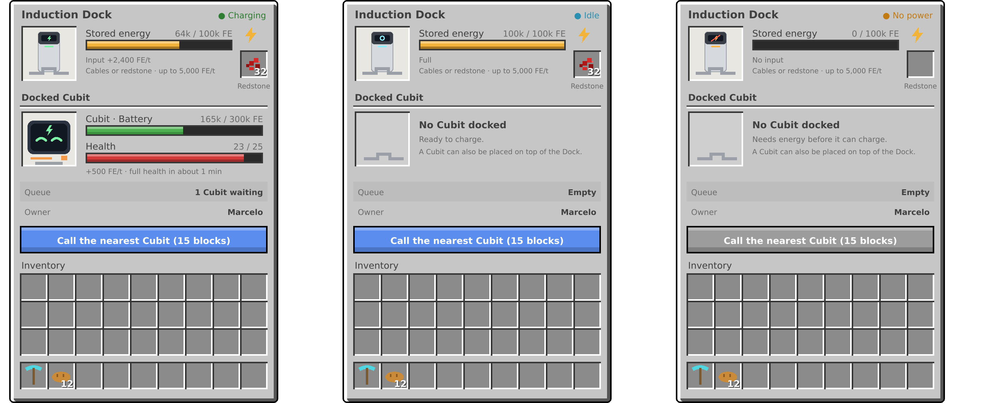

# Telas

As telas próprias do Cubit e do Induction Dock, item 19 da Fase 3. Elas substituem a tela do baú do jogo e o painel lateral, com o estilo das imagens de conceito, e não o do Minecraft (perguntas 371 e 675 a 692).

## Princípios

- **Fidelidade:** as telas seguem as imagens ao máximo. Onde uma resposta em [`perguntas/`](../perguntas/fase-3-sentidos.md) diz outra coisa, vale a resposta (pergunta 676).
- **Estilo:** janelas próprias, com textura que lembra o metal de um robô, sem a textura do baú do jogo (pergunta 371).
- **Textos:** em inglês, no `en_us.json`, e em português, no `pt_br.json` (pergunta 712). Títulos, rótulos e valores usam 75% da fonte do jogo, e os detalhes, cerca de 56%, numa redução proporcional (pergunta 705, que muda a 437 nas telas). Nada passa da borda, e um tooltip mostra o texto inteiro.
- **Retratos:** sprites 2D. O retrato do Cubit monta a moldura com a tela do rosto, reaproveitando as texturas de expressão que já existem, com a piscada, e a cor do colar do tier. A torre do Dock é um sprite próprio, com a luz do estado (pergunta 690).
- **Números:** estoques e baterias abreviados, como `214k / 300k FE`, com `M` acima de um milhão. Taxas por tick inteiras, com separador de milhar, como `+2,400 FE/t`. O Jade continua com os números inteiros (pergunta 687).

## Tela do Cubit

### Quem abre

- **Só o dono**, validado no servidor (regra 20).
- **Ativo ou hibernando**, como na tabela de estados do domínio. O Cubit desligado, sem bateria ou desligado com carga, não abre a tela, e a redstone continua entrando pelo clique com ela na mão (perguntas 45 e 677). A imagem "Off" não se aplica.
- **Se ele desligar com a tela aberta**, ela fecha na hora, e o item no cursor volta ao inventário do player, sem perder nem duplicar (pergunta 684).

### Abas

Três abas, à direita da janela: **Inventory**, com o ícone do baú, **Settings**, com a engrenagem, e **Defense**, com o escudo (perguntas 824 e 828). A aba é estado só do cliente. Fora da Inventory, os slots ficam desligados e não podem ser usados.

### Aba Inventory

| Parte | O que mostra |
|---|---|
| Retrato | A expressão atual, na moldura, com a cor do colar do tier |
| Nome | O nome do Cubit, ou `Cubit`, com a etiqueta do tier, como `BASE` |
| Estado | No canto superior direito, colorido. Veja [Estados do topo](#estados-do-topo) |
| Health | Barra vermelha e `18 / 25` |
| Battery | Barra verde, vermelha só na bateria crítica (pergunta 681), e `214k / 300k FE` |
| Recarga | Uma linha sob a bateria, como `Solar +5 FE/t`, `Slot +500 FE/t` ou `Dock +500 FE/t`. Veja os [textos sem imagem](#textos-sem-imagem) |
| Slot de energia | O slot de redstone, com o rótulo `Redstone` |
| Inventário do Cubit | `Cubit's inventory`, ou com o nome dele, como `Bolt's inventory` |
| Inventário do player | `Inventory` e a hotbar |

- **Rolagem nos tiers altos:** a janela tem sempre a altura da do Base, com 3 linhas do inventário do Cubit à vista, para não passar da altura da tela (perguntas 838 e 839). Com mais de 27 slots, uma barra de rolagem fica à direita do inventário, e a janela ganha a largura dela. A roda do mouse sobre o inventário, um clique na barra ou arrastar o marcador mudam a linha de cima. O servidor recebe a rolagem como botão de menu, confere o limite e manda os itens da parte à vista.
- **Shift + clique** de um item do player procura espaço no inventário inteiro do Cubit, e não só nas linhas à vista.

### Estados do topo

| Estado | Quando | Texto | Cor |
|---|---|---|---|
| Bateria crítica | Ativo, com a bateria crítica, que vence os dois de baixo | `● Critical battery` | Vermelho |
| Seguindo | Ativo, seguindo o dono | `● Following` | Verde |
| Ativo | Ativo, sem seguir ninguém (pergunta 686) | `● Active` | Cinza |
| Hibernando | Na base | `● Hibernating · Dock` | Azul |

### Aba Settings

- **Cabeçalho:** `Settings`, a etiqueta do tier, `Battery 71%` e, ao lado, o botão `Power`, com o ícone de energia (perguntas 857 e 861). O clique desliga o Cubit e fecha a tela. Ligar de novo continua pelo clique direito nele. Hibernando no Dock, o botão fica desabilitado. A dica do botão é `Power` / `Energia` e `Turns the Cubit off` / `Desliga o Cubit` (pergunta 860).
- **Functions:** as quatro chaves, com ON e OFF, em linhas de 18 px (pergunta 861).

| Chave | Descrição |
|---|---|
| `Lamp` | `Lights up below level 8 · 1 FE/t`. Desabilitada ao hibernar, mantendo o valor (pergunta 473) |
| `Scanners` | `Ores 5 blocks · mobs 8 · 50 FE per scan` |
| `Chatter` | `Weather, biomes and reactions` |
| `Solar panel` | `Charges in the sun · 5 FE/t`, com o número do tier de dia. Começa ligada e fica no item (perguntas 859 e 860) |

- **Scanner filter:** só leitura, com o ícone do minério, `Looking for Coal Ore` e `Right-click the Cubit holding an ore to change it.` (pergunta 688).
- **Status:** `Solar panel`, `Energy use`, `Health` e `Following`.
- **Sem rodapé:** o `More functions arrive with the next updates.` saiu, para as quatro chaves caberem (pergunta 861).

Os números das descrições vêm do config e do tier, nunca fixos no texto (regras 3 e 39).

### Aba Defense

Entra com o choque e os modos de defesa, nos itens 5 e 6 da Fase 4 (perguntas 824 e 829). As regras estão em [`combate.md`](combate.md).

- **Cabeçalho:** `Defense`, a etiqueta do tier e `Battery 71%`, como na Settings.
- **Modos:** uma lista com os quatro, Peaceful, Retaliate, Aggressive e Focus, cada um com o nome, uma descrição curta e o atual marcado. O clique num modo liberado troca o modo, pelo clique de botão de menu do jogo, e o servidor confere o dono e o tier. Os bloqueados ficam apagados, com o tier que os libera (pergunta 833):

| Modo | Descrição |
|---|---|
| `Peaceful` | `Never attacks` |
| `Retaliate` | `Shocks whoever hurts you or the Cubit` |
| `Aggressive` | `Shocks hostile mobs in range` |
| `Focus` | `Shocks only the last mob you hit` (pergunta 849) |
| Bloqueado | `Unlocks at Advanced`, com o tier que libera o modo |

- **Choque:** os números do tier, do config, numa seção `Shock`: `Damage`, `Range` em blocos, `Interval`, como `Every 2 s`, `Cost`, como `2000 FE per shock`, e `Targets`, `The nearest` ou `All in range` (pergunta 835). No Base, que só tem o Pacífico, a seção mostra `Unlocks at Advanced`.

## Tela do Induction Dock

### Quem abre

- **Shift + clique direito**, como hoje. O clique continua chamando ou liberando o Cubit (pergunta 678).
- **Só o dono**, validado no servidor (regra 20).

### Estados

O enum e o nome de contrato `status` não mudam (pergunta 313). Muda só o texto, que o Jade também passa a usar (pergunta 685).

| `DockStatus` | Quando | Texto | Cor |
|---|---|---|---|
| `OFF` | Sem energia e sem Cubit | `● No power` | Laranja |
| `IDLE` | Com energia e sem Cubit | `● Idle` | Azul |
| `CHARGING` | Cubit na base recebendo | `● Charging` | Verde |
| `COMPLETE` | Cubit na base com a bateria cheia | `● Complete` | Verde |
| `NO_ENERGY` | Cubit na base e estoque zerado | `● No power` | Laranja |

### Partes

| Parte | O que mostra |
|---|---|
| Topo | `Induction Dock`, o estado, a torre com a luz do estado, `Stored energy 64k / 100k FE`, com a barra laranja, a linha de entrada e `Cables or redstone · up to 5,000 FE/t` |
| Slot | O slot de redstone, com o rótulo `Redstone` |
| Docked Cubit | Com Cubit: o retrato, `Cubit · Battery 165k / 300k FE`, `Health 23 / 25` e a linha de recarga e vida. Sem Cubit: `No Cubit docked` e as frases das imagens |
| Queue | `Empty`, ou `1 Cubit waiting` |
| Owner | O nome do dono, ou `Unknown` (pergunta 689) |
| Botão | `Call the nearest Cubit (15 blocks)`, sempre habilitado, mesmo sem energia (pergunta 679) |
| Inventário do player | `Inventory` e a hotbar |

## Como funciona

- **Servidor decide:** o servidor calcula os valores e os envia pelo menu, e o cliente monta os textos pelas chaves do `en_us.json` (regra 19).
- **Botões:** a chave das funções e o botão de chamar usam o clique de botão de menu do próprio jogo, validado no servidor, sem pacote próprio (pergunta 683).
- **Menus:** `RobotMenu` e `InductionDockMenu` evoluem, sem menus paralelos, com `RobotScreen` e `InductionDockScreen`.
- **Valores grandes:** um valor do menu só leva 16 bits. Bateria e estoque, que passam disso, vão divididos em duas partes e são remontados no cliente.
- **Cubit na base:** o Dock o lê por uma capability de entidade do NeoForge, uma interface curta de leitura, sem depender da classe do robô (regra 42 e pergunta 696).
- **Último tick:** o gasto, as causas, a recarga e o painel ficam num attachment do robô, sem save e sem rede, que o menu lê no servidor (pergunta 698).
- **O que vai ao abrir:** o que não muda com a tela aberta, como o nome do dono, o tier e o filtro do scanner, vai junto da abertura.
- **Regras:** a escolha do estado do topo e o formato dos números ficam em `domain/`, testados com JUnit. A `RobotEntity` não recebe código novo, porque está perto do limite de 400 linhas.

## Textos sem imagem

Estes textos não aparecem nas imagens. O agente os propôs (pergunta 692), e o desenvolvedor aprovou todos (pergunta 693).

### Tela do Cubit

| Onde | Situação | Texto |
|---|---|---|
| Linha de recarga | Hibernando, com o Dock carregando | `Dock +500 FE/t`, como na imagem |
| Linha de recarga | Hibernando, com o Dock sem energia | `Dock · no power` |
| Linha de recarga | Hibernando, com a bateria cheia | `Dock · full` |
| Linha de recarga | Ativo, com redstone sendo consumida no slot | `Slot +500 FE/t`, como na imagem, que vence o solar |
| Linha de recarga | Ativo, com o painel carregando | `Solar +5 FE/t`, como na imagem |
| Linha de recarga | Ativo, sem nada carregando | `Not charging` |
| `Solar panel` | Carregando | `Charging · 5 FE/t`, em verde, como na imagem |
| `Solar panel` | Coberto | `No sky · not charging`, em laranja, como na imagem |
| `Solar panel` | À noite, no tier Base | `Night · not charging`, em laranja |
| `Solar panel` | No Nether ou no End | `No sun here · not charging`, em laranja |
| `Solar panel` | Com a bateria cheia | `Battery full`, em cinza |
| `Solar panel` | Hibernando | `Off · hibernating`, em cinza |
| `Solar panel` | Com a chave desligada | `Off`, em cinza (pergunta 860) |
| `Energy use` | Parado, sem a lanterna | `0 FE/t · idle` |
| `Energy use` | Várias causas juntas | A soma e as causas, nesta ordem: `walking`, `full inventory`, `water`, `climbing`, `danger` e `lamp`, como `16 FE/t · walking, lamp` |
| `Energy use` | Hibernando | `0 FE/t · hibernating` |
| `Health` | Fora da base | `18 / 25 · recovers at the Dock`, como na imagem |
| `Health` | Hibernando, com vida a recuperar | `22 / 25 · recovering` |
| `Health` | Vida cheia | `25 / 25` |
| `Following` | Seguindo o dono | `You`, como na imagem |
| `Following` | Sem seguir ninguém | `Nobody` |
| `Scanner filter` | Sem filtro | `No filter · rare ores only` |

### Tela do Dock

| Onde | Situação | Texto |
|---|---|---|
| Linha de entrada | Recebendo energia | `Input +2,400 FE/t`, como na imagem: a média do que entrou no último segundo |
| Linha de entrada | Estoque cheio | `Full`, como na imagem |
| Linha de entrada | Sem receber e sem estar cheio | `No input`, como na imagem |
| Docked Cubit | `CHARGING` | `+500 FE/t · full health in about 1 min`, como na imagem, com o tempo arredondado para minutos |
| Docked Cubit | `CHARGING`, com a vida cheia | `+500 FE/t · health full` |
| Docked Cubit | `COMPLETE` | `Battery full · full health in about 1 min`, ou `Battery full · health full` |
| Docked Cubit | `NO_ENERGY` | `Not charging · full health in about 1 min`, porque a vida volta mesmo sem energia |
| Docked Cubit | Menos de 1 min | `in under 1 min` |
| Sem Cubit | `IDLE` | `Ready to charge.`, como na imagem |
| Sem Cubit | `OFF` | `Needs energy before it can charge.`, como na imagem |
| Queue | Mais de um | `2 Cubits waiting` |
| Botão | Raio | O raio da chamada do tier Base, lido do config. Com os outros tiers, na Fase 4, o texto é revisto |

## Fora do escopo

- Tudo das Fases 4 e 5: as abas Behavior e Job, a chave geral e as chaves de ímã, coleta, descarga, retorno e local de morte.
- A chave do painel solar, que entra com a interface de configuração (perguntas 494 e 495).
- Os tiers acima do Base.
- O botão para limpar o filtro do scanner (pergunta 688).
- Pacotes próprios do cliente para o servidor (pergunta 683).

## Testes

Pergunta 691.

- **JUnit, no domínio:** a escolha do estado do topo, o formato dos números e a divisão dos valores acima de 16 bits.
- **GameTests:**
  - só o dono abre;
  - Shift + clique no Dock;
  - a tela fecha com o Cubit desligado;
  - o botão de chamar e as chaves;
  - nenhum item duplica.
- **Roteiro manual:** cada tela comparada com a imagem dela.

## Histórico de modificações

| Pessoa | Data e hora | Modificação |
|---|---|---|
| Marcelo Fabiano | 2026-11-12 17:20 | Adiciona a chave do painel solar e o botão Power à aba Settings. |
| Marcelo Fabiano | 2026-11-12 15:10 | Adiciona o modo Focus à aba Defense. |
| Marcelo Fabiano | 2026-11-12 13:10 | Adiciona a rolagem do inventário nos tiers altos. |
| Marcelo Fabiano | 2026-11-12 11:40 | Detalha os textos da seção do choque. |
| Marcelo Fabiano | 2026-11-12 10:30 | Adiciona a aba Defense. |
| Marcelo Fabiano | 2026-11-08 00:11 | Cita a tradução para o português. |
| Marcelo Fabiano | 2026-11-07 23:46 | Tira da tabela de estados as linhas de histórico que caíram nela. |
| Marcelo Fabiano | 2026-11-07 23:19 | Diminui os textos na mesma proporção. |
| Marcelo Fabiano | 2026-11-07 22:57 | Registra a leitura do último tick. |
| Marcelo Fabiano | 2026-11-07 22:44 | Registra a leitura do Cubit pelo Dock. |
| Marcelo Fabiano | 2026-11-07 22:34 | Registra a aprovação dos textos sem imagem. |
| Marcelo Fabiano | 2026-11-07 22:31 | Define as telas próprias do Cubit e do Induction Dock. |
