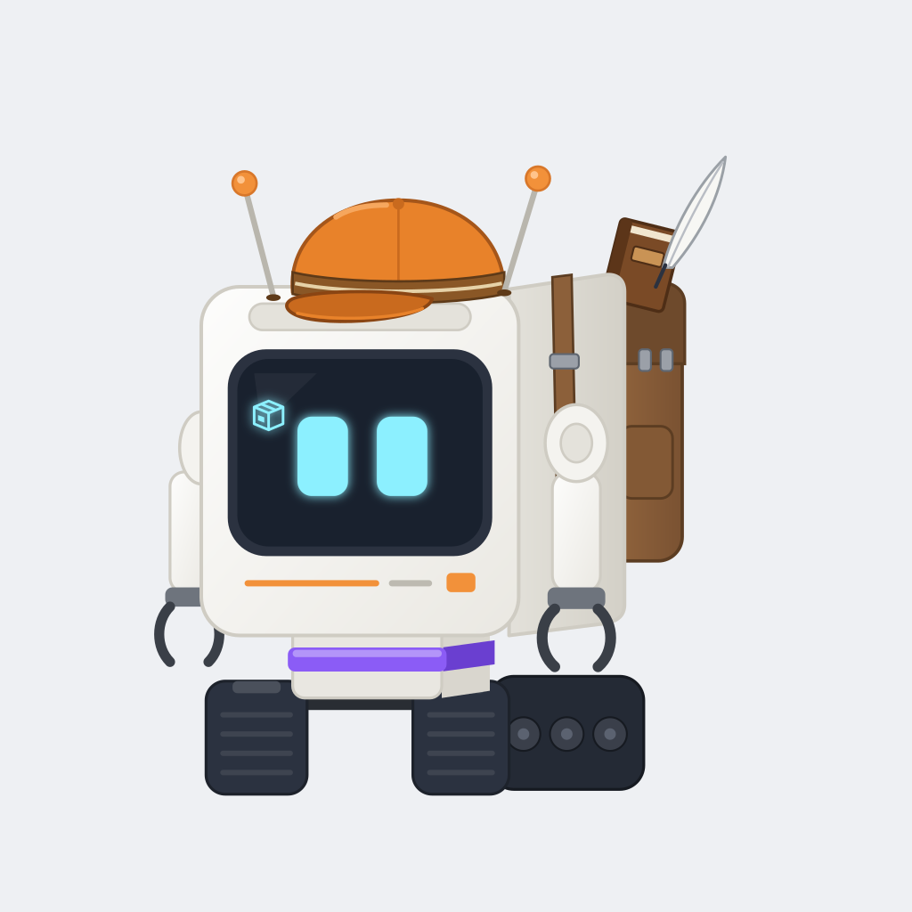

# Organizador

Conceito do trabalho de Organizador, da Fase 5.2, entregue no card #196. O documentado pode mudar se aparecer um impedimento técnico (regra 48 do `AGENTS.md`). Ele complementa [`trabalhos.md`](../trabalhos.md), cujas regras de toda área e a [base do trabalho](../trabalhos.md#base-do-trabalho) valem aqui.

**Situação:** decidido. O comportamento base vem das [perguntas 208, 212, 215, 249 e 250](../../perguntas/fase-5-trabalhos.md), o tier mínimo, o Elite, da pergunta 1145, e o refinamento do card, das perguntas 1285 a 1300. Os números ficam em [`tiers.md`](../../tiers.md#trabalhos).

## A ideia

Um Cubit que mantém a base arrumada: recolhe o que as máquinas produzem e o que está no chão e guarda junto dos itens iguais. Também abastece lugares com quantidades fixas, o que antes seria o Fabricador.

## Imagem conceito



Aceita na pergunta 1311. No mod, o livro e pena é o item do jogo.

## Card

| Nome | ID | Descrição |
|---|---|---|
| Machine Learning: Organizer | `cubit:ml_organizer` | Card de Aprendizado de Máquina do trabalho de Organizador |

Segue as regras dos outros cards: slot exclusivo, um por Cubit, sai sem perda e só age em área marcada. Disponível a partir do Elite, e fica na aba do mod no criativo, como os outros cards.

### Receita

Com forma, em JSON gerado por datagen, na mesma família dos cards do Pescador e do Fazendeiro (pergunta 1299):

```text
P C P
R F R
P R P
```

| Letra | Item | Quantidade |
|---|---|---|
| `P` | Papel | 4 |
| `C` | Comparador | 1 |
| `R` | Redstone | 3 |
| `F` | Funil | 1 |

## Como o player o põe para trabalhar

1. O app Área marca a área, como nos outros trabalhos.
2. O app Descarga marca os baús onde ele guarda e de onde ele tira. Com o card, o limite de baús é o `organizer_chests` do tier, no lugar do `unload_chests` (pergunta 1287).
3. O app Marcar, na cor verde-azulada, marca as máquinas, no modo organizar, ou os destinos, no modo abastecer. Ele só aparece na roda do Tablet com o card do Organizador, e as setas das marcas dizem o Cubit e o número da marca, como `Mark 2` (perguntas 1288, 1297 e 1305).
4. Na aba Trabalho, o player escolhe o modo. No abastecer, monta os pedidos na aba `Supply` (perguntas 1290, 1295 e 1303).

Ele só usa os baús, as máquinas e os destinos que estão dentro da área, porque nunca sai dela.

## Modo

Um por vez, na linha `Mode` / `Modo` da aba Trabalho, entre `Organize` / `Organizar` e `Supply` / `Abastecer`. Começa em organizar e fica no item. Para fazer os dois, o player usa dois Cubits (pergunta 1290).

## Modo organizar

- **Recolher:** pega os itens do chão da área e tira o que as máquinas marcadas oferecem pela face de baixo, como um funil embaixo delas. No forno do jogo, isso é o resultado e o balde vazio. Vale para máquinas de outros mods que oferecem saída pela capability do NeoForge (perguntas 208, 215 e 1289).
- **Guardar:** põe cada item no baú marcado que tem mais do mesmo item. Mesmo item é o mesmo item com os mesmos dados, a regra do jogo para empilhar, então um item encantado, uma poção ou um item com nome não se misturam com o comum (perguntas 208 e 1293).
- **Sem baú com o item:** usa o primeiro baú com espaço, na ordem em que foi marcado. Para mudar a ordem, o player desmarca e marca de novo (perguntas 212 e 1291).
- **Sem lugar:** fica com o item no inventário, avisa uma vez com `Cubit: No room for some items` / `Cubit: Não há lugar para alguns itens` e continua com o que cabe. Com o inventário cheio, hiberna com `Hibernating · Inventory full` (pergunta 1292).
- **Leitura:** varre as máquinas e o chão a cada `organizer_scan_interval_ticks` do tier, com o limite de blocos lidos por tick (pergunta 215 e regra 21).
- **Descarga:** guardar pela regra acima é a descarga dele. O Organizador não faz a descarga comum, que põe tudo no primeiro baú com espaço, nem pelo inventário cheio, nem pelo intervalo. O botão `Descarregar` do Tablet continua valendo, como ordem direta do player.
- **Vários Organizadores:** cada um reserva a máquina, o item do chão ou o destino antes de ir, como o Fazendeiro reserva a planta.

## Modo abastecer

- **Pedido:** cada destino marcado é um pedido, com o item, com os dados, e a quantidade, de 1 a 64, que começa em 64. Até o player escolher o item, o destino não recebe nada (perguntas 1294, 1300 e 1304).
- **Aba `Supply` / `Abastecer`:** só aparece com o card do Organizador, na tela do Cubit e no Tablet, com o card como ícone. O título diz os destinos marcados e o limite do tier, como `Supply · 3 of 8`. Cada destino vira uma linha com a posição e a face, com ↑ em cima, ↓ embaixo e → nos lados, um slot fantasma para o item e − e + para a quantidade, que andam de 1 em 1 e, com Shift, de 8 em 8. O clique no slot com um item o escolhe, e com a mão vazia limpa o pedido. Ela mostra 5 linhas por vez, a roda do mouse rola, e o inventário do player fica embaixo, para pegar o item. Se o card sair com a aba aberta, a tela volta à aba Trabalho (perguntas 1295, 1303 e 1305).
- **Face:** o destino guarda a face em que o player clicou ao marcar, e o Cubit põe o item por ela, como o jogo faz ao apontar um funil. Na fornalha, a face de cima abastece a entrada, e a do lado, o combustível (pergunta 1296).
- **Atender:** a cada varredura, ele conta o item no destino pela face. Se faltar, tira de qualquer baú da Descarga que tenha o item e completa até a quantidade, sem passar dela (perguntas 249 e 1294).
- **Sem o item nos baús:** o pedido espera a próxima varredura, sem hibernar.
- **Sem item no pedido:** a linha fica vazia, e o destino não recebe nada.
- **Sobra:** o que ele carrega e nenhum pedido pede volta aos baús, pela regra do modo organizar.

## Proteção

Só o Organizador mexe em blocos com dados, e só assim: tira pela face de baixo das máquinas marcadas, põe e tira nos baús da Descarga e põe nos destinos pela face marcada, sempre pela capability do NeoForge. Ele nunca quebra o bloco nem mexe na entrada ou no combustível de uma máquina marcada para organizar (pergunta 1289). Cada transferência tira de um lado e põe no outro por completo, sem criar nem perder itens (regra 13).

## Evolução por tier

Decidida na pergunta 1300, com os valores no config:

| Recurso | Elite | Ultimate |
|---|---|---|
| Modo organizar e modo abastecer | ✔ | ✔ |
| Baús marcados, `organizer_chests` | 9 | 18 |
| Máquinas ou destinos marcados, `organizer_marks` | 8 | 16 |
| Custo por pilha movida, `organizer_action_cost` | 50 FE | 50 FE |
| Pausa entre ações, `organizer_action_pause_ticks` | 12 ticks | 6 ticks |
| Intervalo da varredura, `organizer_scan_interval_ticks` | 100 ticks | 40 ticks |

## Visual

Só visual, sempre com o card, no padrão dos trabalhos: um chapéu e a mesma mochila do Pescador e do Fazendeiro, com a ferramenta do jogo (perguntas 1307 e 1308, que mudam a 1298):

- **Boné:** um boné laranja de almoxarifado, com aba curta para a frente e uma faixa marrom de papelão. Cobre o painel solar, que continua carregando.
- **Mochila:** a mesma dos outros trabalhos, com o livro e pena do jogo preso nela.
- **Livro e pena:** na mochila, é parte do modelo, um livro marrom em pé com a pena branca inclinada para fora, como na imagem conceito, porque o item plano do jogo ficava ruim ali. Na hora de tirar ou pôr um item, o item livro e pena do jogo vai para a garra direita, e as duas peças somem da mochila (pergunta 1312).
- **Ícone na tela:** uma caixa pequena no canto esquerdo da tela, como o trigo do Fazendeiro.
- **Arte:** a imagem conceito, o ícone da tela e a textura do boné são feitos por prompt, em `tmp/arte/organizador/prompt.md` (pergunta 1310).
- **Card:** a textura do item segue o modelo dos outros cards, com o topo marrom de papelão e uma caixa com etiqueta (pergunta 1305).

## Contrato

| Tipo | Nome | O que guarda |
|---|---|---|
| Item | `cubit:ml_organizer` | O card, na tag `cubit:ml_cards` |
| Receita | `cubit:ml_organizer` | A receita do card |
| Componente do item | campo `organizer_mode` do `cubit:robot_state` | O modo, `organize` ou `supply`, com `organize` quando falta |
| NBT da entidade | `OrganizerMode` | O modo |
| NBT da entidade | `MarkedBlocks` | As máquinas ou os destinos, em ordem: `Block`, a posição num `long`, `Dimension`, `Face`, o número de 0 a 5 do jogo, `Count`, a quantidade do pedido, e `Item`, o item do pedido, quando há. Sem a chave, o Cubit não tem marcas. Uma marca inválida fica de fora e vai para o log. A chave é a mesma do Cozinheiro (pergunta 1327) |
| Componente do item | `cubit:tablet_app` com `mark` | O app Marcar ativo no Tablet |
| Pacote do servidor | `cubit:organizer_marks` | As marcas dos Cubits do player, para as setas, a cada segundo com o Tablet na mão |
| Config, por tier | `organizer_chests` e `organizer_marks` | Os baús e as marcas do tier |
| Config, por tier | `organizer_action_cost`, `organizer_action_pause_ticks` e `organizer_scan_interval_ticks` | O custo por pilha movida, a pausa entre ações e o intervalo da varredura |

As marcas não vão para o item: recolher o Cubit as apaga, como a área e os baús (perguntas 343 e 1297).

## Histórico de modificações

| Pessoa | Data e hora | Modificação |
|---|---|---|
| Marcelo Fabiano | 2026-11-19 23:06 | Troca a chave das marcas para `MarkedBlocks` (pergunta 1327). |
| Marcelo Fabiano | 2026-11-19 22:47 | Recria o livro e pena da mochila como parte do modelo (pergunta 1312). |
| Marcelo Fabiano | 2026-11-19 22:41 | Acrescenta a imagem conceito aceita (pergunta 1311). |
| Marcelo Fabiano | 2026-11-19 22:36 | Troca o visual para o boné, a mochila e o livro e pena (perguntas 1307 e 1308). |
| Marcelo Fabiano | 2026-11-19 22:13 | Registra os detalhes de tela, o NBT completo e a arte pendente (pergunta 1305). |
| Marcelo Fabiano | 2026-11-19 21:52 | Leva os pedidos à aba `Supply`, com 64 no começo, e detalha a descarga e a reserva (perguntas 1303 e 1304). |
| Marcelo Fabiano | 2026-11-19 21:34 | Fecha o conceito do Organizador, com o app Marcar, os pedidos, a exceção à proteção e os números (perguntas 1285 a 1300). |
| Marcelo Fabiano | 2026-11-14 20:25 | Leva o conceito de `tmp/fase5` para `_docs`, com as decisões da consolidação (perguntas 1145 a 1156). |
| Marcelo Fabiano | 2026-11-13 11:43 | Cria o conceito do Organizador, com os modos das perguntas 208 a 250 e a proposta para fechar a pergunta 208. |
