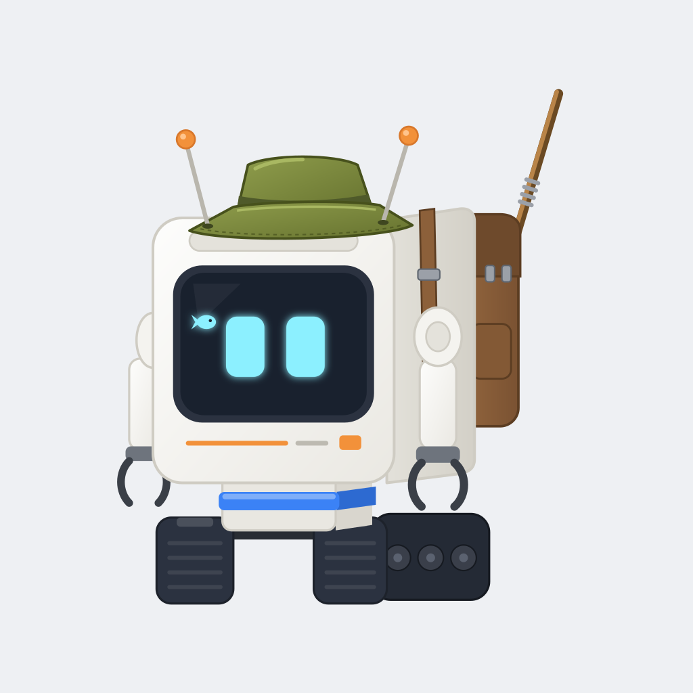

# Pescador

Conceito do trabalho de Pescador, da Fase 5.2, entregue no card #194. O documentado pode mudar se aparecer um impedimento técnico (regra 48 do `AGENTS.md`). Ele complementa [`trabalhos.md`](../trabalhos.md), cujas regras de toda área e a [base do trabalho](../trabalhos.md#base-do-trabalho) valem aqui.

**Situação:** decidido. O comportamento base vem da [pergunta 248](../../perguntas/fase-5-trabalhos.md), o tier mínimo, o Avançado, da pergunta 1145, e o refinamento do card, das perguntas 1181 a 1204. Os números ficam em [`tiers.md`](../../tiers.md#trabalhos).

## A ideia

Um Cubit que pesca sozinho na água da área marcada, sem vara e sem boia de verdade, e guarda o que pegar. É o primeiro trabalho da ordem de entrega.

## Imagem conceito



O visual da pergunta 1196, com o chapéu, a mochila com a vara e o ícone de peixe na tela, aceito na pergunta 1212. Substitui a imagem da pergunta 1177.

## Card

| Nome | ID | Descrição |
|---|---|---|
| Machine Learning: Fisher | `cubit:ml_fisher` | Card de Aprendizado de Máquina do trabalho de Pescador |

Segue as regras dos outros cards: slot exclusivo, um por Cubit, sai sem perda e só age em área marcada. Disponível a partir do Avançado.

### Receita

Com forma, em JSON gerado por datagen e só com materiais do jogo puro (pergunta 1192):

```text
P C P
R F R
P R P
```

| Letra | Item | Quantidade |
|---|---|---|
| `P` | Papel | 4 |
| `C` | Comparador | 1 |
| `R` | Redstone | 3 |
| `F` | Vara de pesca | 1 |

## Como o player o põe para pescar

Sem app novo no Tablet (pergunta 1186). Com o card no slot:

1. O app Área marca os dois cantos da área, como no [modo área](../modo-area.md). A área de um Cubit com o card do Pescador é a área de pesca.
2. O app Descarga marca o baú onde ele guarda o que pescou, como na [descarga em baú](../inventario.md#descarregar-em-baú).

O app de marcar blocos do trabalho (pergunta 1155) continua para o primeiro card que precisar dele.

## Como ele trabalha

### O ponto de pesca

- **Varredura:** ele procura, dentro da área e só nos chunks carregados, um lugar livre, de pé, na margem de água-fonte, e um ponto de água-fonte a até 6 blocos dele, o alcance do lançamento. Dá preferência a um ponto com água aberta, que libera o tesouro. O lugar e o ponto ficam dentro da área (perguntas 1188 e 1208).
- **Quando varre:** ao chegar na área, ao acordar pelo `Retomar` e quando o ponto deixa de servir, com o limite de blocos lidos por tick de [`tiers.md`](../../tiers.md#valores-gerais). Pescando, ele confere o ponto a cada pesca (pergunta 1204). A água aberta pede um lago com mais de 5×5 blocos e 2 de fundo, porque a margem não pode cair no volume de 5×5 em volta do ponto.
- **Vários Pescadores:** cada um reserva o seu ponto, e outro não o usa (pergunta 1189). O limite de Cubits por área continua o mesmo.
- **Sem ponto:** se a varredura completa não achar ponto livre, ele hiberna fora do Dock pelo motivo `No water in the area` / `Sem água na área`, com o texto curto `I can't find water to fish here` / `Não acho água para pescar aqui`. O texto sai uma vez ao hibernar, e de novo se o `Retomar` não resolver (perguntas 1187, 1188 e 1195).

### A pesca

- **Tempo:** como no jogo (pergunta 1184). A espera é sorteada entre 100 e 600 ticks, menos 100 por nível de Isca, e depois vem a mordida, de 20 a 80 ticks. Na chuva, cada tick tem 25% de chance de contar dois, e, sem céu, 50% de chance de não contar. Os limites ficam no config. Na média, uma pesca leva cerca de 20 s sem Isca e cerca de 7 s com Isca III.
- **Prêmio:** sai da tabela do jogo, `minecraft:gameplay/fishing`, com a Sorte do Mar do tier somada à sorte. O jogo dá tesouro só em água aberta e confere isso pela boia, então o Cubit usa uma boia virtual, fora do mundo, só para a conta.
- **Água aberta:** a regra do jogo, de `FishingHook.calculateOpenWater`: um volume de 5×4×5 em volta do ponto na água, em camadas, só com água-fonte embaixo e ar ou vitória-régia em cima. Fora dela, ele pesca só peixe e lixo (pergunta 1183).
- **Custo:** um valor fixo de FE por peixe pescado. Parado, o Cubit não gasta nada, e a espera também não (pergunta 1190).
- **Experiência:** nenhuma. O Cubit não é um player e não gera orbes (pergunta 1203).
- **Lixo:** com a chave `Keep junk` / `Guardar lixo` desligada, o lixo pescado é descartado sem entrar no inventário nem ir para o chão. Ela fica ligada por padrão (pergunta 1191). Lixo é o item da tag `cubit:fishing_junk`, com os itens do lixo da tabela do jogo, e um item encantado nunca é lixo, para a vara e o arco do tesouro ficarem (pergunta 1207).
- **Inventário cheio:** descarrega no baú marcado. Sem onde descarregar, hiberna pelo inventário cheio, como na base.

### Na tabela do jogo

Os pesos, conferidos em `gameplay/fishing.json`, são o peso mais a qualidade vezes a sorte:

| Grupo | Peso | Qualidade | Sem Sorte do Mar | Sorte do Mar III |
|---|---|---|---|---|
| Lixo | 10 | −2 | 10% | ~4% |
| Tesouro, só em água aberta | 5 | +2 | 5% | ~11% |
| Peixe | 85 | −1 | 85% | ~85% |

## Evolução por tier

Decidida na pergunta 1185, com os valores no config:

| Recurso | Avançado | Elite | Ultimate |
|---|---|---|---|
| Isca (pesca mais rápido) | — | II | III |
| Sorte do Mar (mais tesouro, menos lixo) | — | II | III |

## Aba Trabalho

Além do que a base mostra, a aba ganha a chave `Keep junk` / `Guardar lixo`, ligada por padrão. Ela fica no NBT da entidade e no item do Cubit, como as outras chaves (pergunta 1191). Hibernando sem água, a aba mostra `Hibernating · No water in the area` / `Hibernando · Sem água na área`.

## Visual

Só visual: a pesca continua sem vara e sem boia (perguntas 248 e 1196).

- **Quando:** sempre que o card está no slot, até seguindo o player (pergunta 1197).
- **Chapéu e mochila:** ossos novos no modelo GeckoLib, `fisher_hat` e `fisher_backpack`, escondidos sem o card, com uma textura própria feita por prompt (pergunta 1200). O chapéu cobre o topo e esconde o painel solar, que continua carregando (pergunta 1201).
- **Vara:** a vara de pesca do jogo, desenhada por uma camada do GeckoLib, fica na mochila. Pescando, ela passa para a garra direita, e ele ergue o braço numa animação nova, `fishing`. Fora da pesca, ela volta para a mochila (pergunta 1199).
- **Ícone na tela:** um peixe pequeno, feito por prompt, no canto esquerdo da tela, por cima da expressão. Brilha no escuro como a tela, aparece em todas as expressões e some quando a tela apaga, desligado ou hibernando. Cada card terá o seu ícone (pergunta 1202).
- **Efeitos:** sem linha e sem boia. A cada peixe, as partículas de respingo e o som do jogo de recolher a linha, no ponto da água (pergunta 1198).

## Contrato

| Tipo | Nome | O que guarda |
|---|---|---|
| Receita | `cubit:ml_fisher` | A receita do card, em `data/cubit/recipe/` |
| Tag de item | `cubit:fishing_junk` | O lixo que a chave `Keep junk` descarta: vitória-régia, botas de couro, couro, osso, poção, linha, vara de pesca, tigela, graveto, bolsa de tinta, gancho, carne podre e bambu. O pack pode editar |
| Motivo de hibernar | `no_water`, no NBT `HibernationReason` | Sem ponto de pesca na área |
| NBT da entidade | `KeepJunkEnabled` | A chave `Keep junk`. Sem a chave, vale ligada |
| Componente do item | `keep_junk_enabled`, em `cubit:robot_state` | A mesma chave no item do Cubit e no Damaged Cubit. Sem o campo, vale ligada |
| Config, por tier | `fisher_lure_level` e `fisher_luck_level` | Os níveis de Isca e de Sorte do Mar, de 0 a 3 |
| Config, por tier | `fisher_catch_cost` | O custo por peixe pescado |
| Config, `general` | `fisher_wait_min_ticks`, `fisher_wait_max_ticks`, `fisher_bite_min_ticks`, `fisher_bite_max_ticks` e `fisher_lure_ticks_per_level` | Os limites do tempo da pesca |
| Config, `general` | `fisher_cast_reach_blocks` | O alcance do lançamento, de 1 a 16, com 6 (pergunta 1208) |

A reserva dos pontos fica só na memória do servidor e não vai para o save.

## Histórico de modificações

| Pessoa | Data e hora | Modificação |
|---|---|---|
| Marcelo Fabiano | 2026-11-15 09:30 | Troca a imagem conceito pela do visual novo (pergunta 1212). |
| Marcelo Fabiano | 2026-11-14 23:10 | Fecha o refinamento do card #194, com as perguntas 1181 a 1204: o app Área, o ponto de pesca, o tempo e a tabela do jogo, a evolução por tier, o lixo, com a tag da pergunta 1207, a receita, o visual e o contrato. |
| Marcelo Fabiano | 2026-11-14 21:37 | Acrescenta a imagem conceito do Pescador (pergunta 1177). |
| Marcelo Fabiano | 2026-11-14 20:25 | Leva o conceito de `tmp/fase5` para `_docs`, com as decisões da consolidação (perguntas 1145 a 1156). |
| Marcelo Fabiano | 2026-11-13 11:43 | Cria o conceito do Pescador, com o comportamento da pergunta 248 e a proposta de evolução por tier. |
