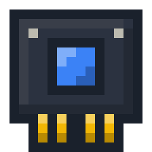
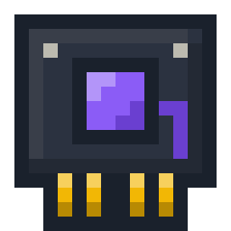
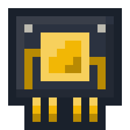

# Upgrade de tier

O Cubit sobe de tier com um Module, sem pular etapas: Base → Advanced → Elite → Ultimate (perguntas 226, 93 e 797 a 806). Os números de cada tier estão em [`tiers.md`](../tiers.md), e o nome, o ID e a receita de cada Module, em [`itens.md`](../itens.md#modules).

| Advanced Module | Elite Module | Ultimate Module |
|---|---|---|
|  |  |  |

## Os Modules

- **Um por tier:** o Advanced leva do Base ao Advanced, o Elite, do Advanced ao Elite, e o Ultimate, do Elite ao Ultimate.
- **Visual:** um cartucho de circuito escuro, com conectores dourados embaixo e um núcleo na cor do colar do tier. O Elite ganha uma trilha a mais, e o Ultimate, duas trilhas e uma moldura clara em volta do núcleo (pergunta 806).
- **No inventário:** empilha até 64, e o nome aparece na cor do colar do tier: azul, roxo ou dourado (pergunta 804).
- **Dica:** mostra o tier que o Cubit precisa ter para receber o Module, como `Requires an Advanced Cubit` (perguntas 802 e 808).

## Como aplicar

- **Clique direito no Cubit**, com o Module na mão. O Module é consumido, menos no criativo, e o inventário não abre.
- **Só o dono** aplica (regra 20). O clique de quem não é dono não faz nada, sem texto, e o Module não é consumido, como na pintura e na etiqueta (pergunta 809).
- **Em qualquer estado:** ativo, desligado, sem bateria ou hibernando no Dock, porque o upgrade não gasta energia (pergunta 800).
- **Só no Cubit colocado:** o item do Cubit e o Damaged Cubit não recebem Module.

## O que muda e o que se mantém

| Recurso | Ao subir de tier |
|---|---|
| Vida | A atual se mantém, e a máxima sobe para a do novo tier (pergunta 93) |
| Bateria | A carga se mantém, e a capacidade sobe para a do novo tier |
| Inventário | Os itens se mantêm, e os slots a mais aparecem vazios |
| Velocidade, consumo, recarga, painel, lanterna e scanners | Passam aos números do novo tier |
| Colar e faixas dos antebraços | Passam à cor do novo tier, no mundo e no ícone |
| Nome, cor da carcaça e configurações | Não mudam |
| Recursos bloqueados | Ficam disponíveis quando o tier deles chegar e o recurso já existir no mod |

O tier fica guardado no item ao recolher, morrer e consertar, no campo `tier` de `cubit:robot_state`, que já existe.

## Reação

- **Upgrade aplicado:** expressão feliz e bipe, como ao receber um nome, e um texto curto com o novo tier. Com a tela apagada, só o texto aparece (pergunta 801).
- **Module que não serve:** o Module não é consumido, e um texto curto explica o motivo: o tier que ele exige, ou que o Cubit já tem esse tier ou um maior (pergunta 802).
- **Os textos** respondem ao clique do dono, sem o intervalo mínimo, como no filtro do scanner (pergunta 565). O nome do tier vem traduzido no `pt_br` (pergunta 808):

| Situação | Texto |
|---|---|
| Upgrade aplicado | `Cubit: Upgraded to Elite!` |
| Etapa pulada | `Cubit: I need to be Advanced first`, com o tier que o Module exige |
| Mesmo tier ou acima | `Cubit: I'm already Ultimate`, com o tier atual |

Em português, os itens são `Módulo Avançado`, `Módulo Elite` e `Módulo Supremo`, os textos são `Cubit: Evoluí para Elite!`, `Cubit: Preciso ser Avançado antes` e `Cubit: Já sou Supremo`, e a dica é `Exige um Cubit Avançado` (pergunta 811).

## Ícone do item

O colar do ícone do Cubit e do Damaged Cubit ganha a cor do tier por uma segunda camada, só com o colar em tons claros, que o cliente tinge com a cor do tier. É uma textura só, sem multiplicar os 16 modelos de cor da carcaça (perguntas 414 e 803).

## Fora desta entrega

- O uso dos Modules no Servidor e na antena, que entram na Fase 5 ([`trabalhos.md`](trabalhos.md)).
- Os recursos que dependem do tier e ainda não existem, como o choque, o ímã, o modo área e a fornalha, que entram nos itens seguintes da Fase 4.

## Histórico de modificações

| Pessoa | Data e hora | Modificação |
|---|---|---|
| Marcelo Fabiano | 2026-11-11 23:10 | Acrescenta os nomes e os textos em português. |
| Marcelo Fabiano | 2026-11-11 22:01 | Define o upgrade de tier com os Modules. |
